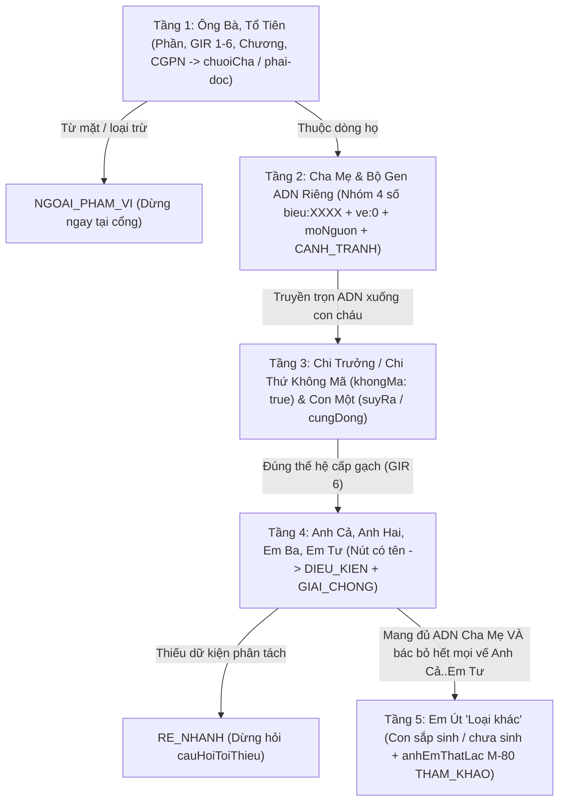

# Skill `doc-tron-nhom` — Đọc Trọn Nhóm 4 Số Theo ADR-0008 (M-81)

## 1. Mục đích, Phạm vi & Quy trình Một Lượt (ADR-0008)

Đọc và số hoá trọn vẹn **một gói nhóm 4 số** trong một lượt duy nhất (`goi-nhom.mjs` → `DIEU_KIEN`, `GIAI_CHONG`, `CANH_TRANH` → `bang-anh-em.mjs` → cổng `6–12` → `so-diem.mjs`), làm tới đâu ăn điểm tới đó và không đọc lại nhóm đã `DONG`.

- **Nơi lưu:** `data/ho-so-ma/dieu-kien/<chương>.jsonl` (`DIEU_KIEN`, `GIAI_CHONG`, `CANH_TRANH`) và `data/ho-so-ma/bang-anh-em/<chương>.jsonl` (máy sinh qua `scripts/ho-so-ma/bang-anh-em.mjs`, không viết tay).
- **Nhánh & Worktree:** Làm việc trên worktree cô lập `/Users/ozvietnamdesktop/Documents/Claude/Projects/hs-code-api-wt/<slug>` với nhánh `agy/...` tách sạch từ `origin/main`.
- **An toàn:** Không sửa đường khách L1 (`api/`, `lib/`, `data/prompts/`, `lib/llm-tier.js`, `lib/llm.mjs`, `lib/ho-so-ma/ghep.js`), không sửa bản ghi dữ liệu cũ trong `data/ho-so-ma/`, không đưa dữ liệu riêng tư (`data/oz-export/*`, `oz-gold*`, `.env`, `.keys/`) hay tiền lệ `tb:` vào điều kiện, tuyệt đối không chạy `gh pr merge` hay push thẳng lên `main`.

### Quy trình 9 bước một lượt cho một nhóm 4 số

1. **Lấy việc từ hàng đợi `so-diem.mjs --hang-doi`:** Chỉ nhận nhóm `CHUA`. Nhóm `DONG` không soạn lại. Nhóm `DO` chỉ sửa đúng bản ghi bị cổng chỉ ra hoặc đúng các nút trong `nutCanMoLai` khi vân tay câu luật đổi. Không cho mô hình phụ/Gemini soạn lại 8 nhóm bảng vàng (chỉ dùng 4 nhóm đầu làm phép đo mù).
2. **Dựng gói đọc trọn nhóm (`goi-nhom.mjs --nhom <4so>`):** Gói gồm cây biểu thuế đầy đủ (`cayBieu`), gia đình anh em (`nhomAnhEm`), luật nền Phần/Chương/Phân chương/nhóm/phân nhóm/SEN (đã loại bỏ `WCO`, `PHAN_BIET`, `PHAN_BIET_NGHIA` và `tb:`), cạnh loại trừ vào/ra (`loaiTru`), hồ sơ M-72..M-75 sẵn có (`NGUONG`, `DINH_NGHIA`, `CHI_LIET_KE`), và `CANH_TRANH` từ `docs/mong/the/M-81-canh-tranh.md`. Nhóm quá dài tự tách `goiCon` theo phân nhóm 6 số nhưng vẫn giữ trọn chuỗi cha và anh em cùng cấp.
3. **Dựng cây cấp gạch đầy đủ:** Giữ nguyên mọi dòng trung gian không mã (`khongMa: true`, ví dụ `bieu:8543702`, `bieu:8543309`, `bieu:90314`, `bieu:4202129`, `bieu:3926903`). Với chuỗi một dòng (`suyRa: true` / `cungDong`, ví dụ `8543.10.00` hay chuỗi nhiều cấp `2308 -> 230800 -> 23080000`), chỉ cần đặt `DIEU_KIEN` / `CANH_TRANH` ở một nút trong chuỗi (ưu tiên nút cha 4/6 số), Cổng 6 & 12 tự đi theo toàn chuỗi `cungDong` không cần lặp bản ghi. Dòng `"Loại khác"` thuần (`loaiKhac: true`) không viết `DIEU_KIEN`; dòng `loaiKhacCoVe: true` (ví dụ `8501.10.22`) phải viết `DIEU_KIEN` cho vế điều kiện thêm.
4. **Tách `DIEU_KIEN` cho mọi nút có tên (`id: hs:<nut>:81NN`):**
   - `ve` (số nguyên `>= 0`): `;` ngoài ngoặc hoặc `hoặc` phân nhánh độc lập ⇒ tăng `ve` (`1, 2, ...`); `và` ⇒ cùng `ve`; **`ve: 0`** ⇒ điều kiện chung áp lên mọi vế (thường là `phu: true` cho `"trừ…"` cuối danh sách, vẫn phải đủ số `ve >= 1` cho tên tách `;`).
   - `phu`: `true` cho `"trừ..."`, `"không kể..."`, `"không phải..."`.
   - `kieu`: `CO_KHONG` (cấm `nguong`, `tap`, `truc`, `daTri`); `SO` (bắt buộc trỏ `nguong` = `id` `NGUONG` M-74, không lặp số, cấm `tap`, `truc`, `daTri`); `GIA_TRI` (bắt buộc `truc` cục bộ trong gia đình anh em + `tap`, cấm `nguong`; tuỳ chọn `daTri: true` khi trục đa trị, mặc định `false` đơn trị).
   - `mo`: `DINH_NGHIA_LUAT` và `MO_TA_HUONG_DAN` bắt buộc kèm `moNguon` (`RE_CAU` trong kho luật gốc hoặc mảng id, kể cả chéo chương, cấm `tb:`); tuỳ chọn `moNguonVanTay` (sha256 hoặc `{ [id]: sha256 }`) do `tach-dieu-kien.mjs` tự gắn để `so-diem.mjs` phát hiện đổi chữ câu định nghĩa kể cả khi chưa có bản ghi `DINH_NGHIA`; `NGUONG` và `NGHIA_THUONG` cấm `moNguon`.
   - `nguon`, `trich`, `vanTay`: trích chuỗi con nguyên văn của câu `nguon` trong gói (`L.cau`), `vanTay = sha256(chu)`.
5. **Tách `GIAI_CHONG` hoặc soi chồng Cổng 8:** Với cặp anh em có thể cùng thoả trên cùng một món hàng (`VUNG_CHONG`), lập `GIAI_CHONG` (`TRU` | `QUY_TAC_3` | `CHU_GIAI` | `NGUONG`) kèm trích luật nguyên văn. Lưu ý: Cổng 8 chỉ chứng minh rời nhau cho `GIA_TRI` khi cùng `truc`, tập `tap` không giao **và cả hai đều đơn trị (`!daTri`)** (hoặc dùng `phu` bù / `SO`). Nếu một bên có `daTri: true`, Cổng 8 gắn `CHUA_CHUNG_MINH_TACH` cho tới khi có `GIAI_CHONG` trích luật.
6. **Lập `CANH_TRANH` (Cổng 12 `BÙ`):** Với mọi nút có cụm `"chưa được chi tiết hoặc ghi ở nơi khác"`, lấy danh sách nhóm cạnh tranh và phép thử từ `M-81-canh-tranh.md` + `nhom:8479:ct:1–7`.
7. **Rút ca thử từ ví dụ chú giải / SEN (Cổng 10 `DÒ`):** Kiểm đủ 3 loại kết quả (`VE_DONG` / `DICH`, `RE_NHANH` khi thiếu dữ kiện, `NGOAI_PHAM_VI` khi bị `ve: 0` hoặc `chuoiCha` loại ra).
8. **Kiểm kê `NGHIA_THUONG` (Cổng 11 `MỞ`):** Đếm đủ, không ép về `0`, mỗi bản ghi phải có `cauHoi` một dòng `<= 300` ký tự để dừng hỏi ở vùng biên.
9. **Chạy cổng & nộp bài sạch:** Chạy `bang-anh-em.mjs`, `cong.mjs --pham-vi <4so> --chi-trong --cong 6..12`, `so-diem.mjs --kiem-nhom <4so>`, `oz-pr-auditor`, rồi mới mở PR (tuyệt đối không chạy `gh pr merge` hay push thẳng lên `main`).

---

## 1b. Học Thuyết "Mỗi Nhóm 4 Số Là Một Gia Đình" (Ánh Xạ 5 Tầng Huyết Thống Sang M-81 & M-80)

Toàn bộ cơ chế M-81 (`ADR-0007`, `ADR-0008`) và `M-80` (`#2404`) vận hành theo học thuyết nghiệp vụ cốt lõi của CEO Anh Thắng: **mỗi nhóm 4 số không phải những dòng rời rạc, mà là một Gia Đình huyết thống 5 tầng khép kín**. Ong đọc trọn nhóm bắt buộc tư duy đúng từ trên xuống dưới theo sơ đồ gia phả sau:



### Tầng 1 — Ông Bà, Tổ Tiên (`Phần` & `Chương` → `chuoiCha` / `phai-doc`)
- Mỗi gia đình 4 số sinh ra trong một dòng họ lớn gồm **Chú giải Phần, 6 Quy tắc tổng quát (GIR 1–6), Chú giải Chương và Chú giải Phân nhóm**.
- Con cháu trong nhà bắt buộc tuân **gia pháp Ông Bà** trước tiên: nếu Ông Bà viết câu từ mặt (loại trừ sang nhóm hoặc chương khác, hoặc quy tắc ưu tiên nhóm khác như `61.11`, `61.13`, `85.24`, `85.41`, `85.42`) → kết luận **`NGOAI_PHAM_VI`** ngay từ cổng, tuyệt đối không xét xuống phân nhóm bên dưới.
- Khi tài liệu hướng dẫn cấp thấp (như SEN) mâu thuẫn trực tiếp với Chú giải Phần/Chương hoặc lời văn dòng biểu (ví dụ `85.01` `sen:85011030`, hoặc `87.08` `sen:87089925` kể gioăng bình nhiên liệu nhưng Chú giải 2(a) Phần XVII loại trừ mọi tấm đệm/vòng đệm), **gia pháp Ông Bà (văn bản pháp lý cao hơn) luôn thắng**; ong giữ đúng luật và ghi rõ vào mục "điểm không chắc", cấm tự sửa chữ luật.

### Tầng 2 — Cha Mẹ & Bộ Gen ADN Riêng (`Nhóm 4 số XXXX` → `DIEU_KIEN` của `bieu:XXXX` + `ve: 0` + `moNguon` + `CANH_TRANH`)
- Mỗi nhóm 4 số là **một gia đình độc lập mang Bộ Gen ADN riêng** (`DIEU_KIEN` tại `bieu:XXXX` + các điều kiện ngoại lệ/ràng buộc chung `ve: 0` + định nghĩa gốc `moNguon`).
- **Quy luật di truyền bắt buộc:** Mọi người con trong nhà (phân nhóm 6 số, chi trung gian không mã, dòng 8 số, kể cả Em Út `"Loại khác"`) đều **di truyền trọn vẹn 100% Bộ Gen ADN của Cha Mẹ và Ông Bà** (`chuoiCha`). Không người con nào được phép trái ADN Cha Mẹ.
- **Gia đình mang họ *"chưa được chi tiết hoặc ghi ở nơi khác"* (`84.79`, `85.43`, `39.26`, `73.26`...):** Phải đối chiếu Bộ Gen ADN với các **gia đình hàng xóm chuyên biệt hơn** thông qua bản ghi `CANH_TRANH` (Cổng 12 `BÙ`), xét đủ câu đẩy ra lẫn câu từ nhóm khác đẩy vào.
- **Gia đình kiểu bộ phận (`87.08`, nhánh bộ phận `8517.7`...):** Bộ Gen ADN của Cha Mẹ là **điều kiện kép**: (1) thuộc đối tượng đích (như xe `87.01–87.05`), **VÀ** (2) vượt qua rào cản pháp lý của Phần/Chương ở `ve: 0` (với `87.08`: thoả Chú giải 3 Phần XVII *"chỉ dùng hoặc chủ yếu dùng"*, không rơi vào danh sách loại trừ Chú giải 2 Phần XVII như bộ phận công dụng chung Phần XV / máy Chương 84 / điện Chương 85 / Chương 90, không được mô tả cụ thể hơn ở Phần khác như lốp `40.11` / kính rời `70.07` / gương `70.09` / ghế `94.01`, và không phải khung gầm có động cơ `87.06` hay thân xe `87.07`).

### Tầng 3 — Chi Trưởng / Chi Thứ Trung Gian (`khongMa: true`) & Con Một (`suyRa: true` / `cungDong`)
- Các dòng tiêu đề gạch ngang trung gian không mang mã số (như `bieu:8543702` *- - Thiết bị điều khiển từ xa, trừ…*, `bieu:61101` *- Từ lông cừu hoặc lông động vật loại mịn:*, `bieu:8517624`, `bieu:8708299:td1`, `bieu:3004101`, hay dòng `- - Loại khác:` có các con bên dưới) là **các nhánh chi trong gia phả** — bắt buộc giữ nguyên để truyền gen của chi xuống các cháu, tuyệt đối không cắt bỏ làm đứt phả hệ.
- Với **con một** (`suyRa: true` / `cungDong`, ví dụ `8543.10.00`, `6110.11.00`, `8708.21.00`, hoặc chuỗi nhiều cấp `2308 -> 230800 -> 23080000`), đặt điều kiện một lần ở nút cha đại diện để con kế thừa nguyên vẹn qua `cungDong`, không sinh bản ghi trùng lặp.

### Tầng 4 — Anh Cả, Anh Hai, Em Ba, Em Tư (Các phân nhóm / dòng có tên cụ thể cùng cấp gạch → `GIR 6`, `DIEU_KIEN`, `GIAI_CHONG`)
- **Chung Cha Mẹ, chung Ông Bà, đúng thế hệ cấp gạch (`GIR 6`):** Chỉ so sánh ngang hàng các anh em cùng một cấp gạch dưới cùng một cha — tuyệt đối cấm đem chú 1 gạch đọ thẳng với cháu 2 gạch.
- **Căn cước từng người con (`DIEU_KIEN`):**
  - Tách đủ mọi vế `HOẶC` (`ve: 1, 2...` theo dấu `;`, chữ `"hoặc"` phân nhánh độc lập, hoặc cụm `"kể cả"` mở thêm phạm vi ngoài vế chính như `85.17` vế 3 / `8517.62` vế 2–3; riêng `"hoặc"` nối các giá trị trên cùng một trục như `61101` *"lông cừu hoặc lông động vật loại mịn"* hay `"kể cả"` chỉ minh hoạ hình thức của chính hàng như `8517.62.41` thì giữ trong một vế).
  - Các điều kiện trong cùng một `ve` kết hợp bằng `VÀ`; mệnh đề `"trừ..."` đặt `phu: true` (`ve: 0` nếu áp chung cho mọi vế, hoặc gắn vào đúng các vế đứng sau dấu `;` như `85.17` vế 2 & 3).
  - Dòng có tên mang chữ `"khác"` phần bù (như `6110.90` *"Từ các vật liệu dệt khác"*, `8708.2` *"Bộ phận và phụ kiện khác của thân xe"*, `3004.20` *"Loại khác, chứa kháng sinh"*, `8517.14` *"Điện thoại khác..."*) biểu diễn bằng phủ định các anh đứng trước (`phu: true` hoặc `GIAI_CHONG` `cach: "TRU"`), cấm liệt kê đóng danh sách mở.
  - Trục `truc` là **nếp nhà cục bộ của từng gia đình anh em**, không ép bảng khoá từ vựng toàn biểu.
- **Thứ tự TRÊN – DƯỚI giữa các anh em (`GIAI_CHONG` — Cổng 8 `CHỒNG`):**
  - Anh đứng trên thường cụ thể hơn hoặc có câu rào `"trừ..."`, còn anh đứng dưới mang chữ `"khác"` (`cach: "TRU"`).
  - **Phần bù anh em ở Cổng 7 & 8 cấm so chuỗi con `trich` (`#2424` Điểm 1, `ADR-0005`):** Ví dụ Anh A `trich: "plastic"` và Anh B `phu: true, trich: "plastic gia cố"` **KHÔNG phải** phần bù của nhau (vì món hàng *"plastic không gia cố"* thoả cả hai!). Hai điều kiện chỉ bù nhau khi **cùng `kieu`** + **cùng `truc` đơn trị (`GIA_TRI`)** / **cùng `nguong` (`SO`)** / **cùng `cauHoi` (`CO_KHONG`)** + **tập/khoảng bằng hệt nhau** + **`phu` ngược dấu**.
  - **Hai anh em đơn điều kiện `SO` cùng đại lượng mà khoảng số giao nhau = `VUNG_CHONG` chặn cứng (`#2424` Điểm 3, `ADR-0009`):** Đây là vùng chồng chứng minh được bằng máy (mạnh hơn phiếu LLM); cả `bang-anh-em` lẫn Cổng 8 đều gắn cờ **`VUNG_CHONG` chặn** cho tới khi có `GIAI_CHONG` giải thích thứ tự trên–dưới theo luật.
  - Khi một món hàng lai thoả cả hai anh em (`VUNG_CHONG`) hoặc xét trên **trục đa trị (`daTri: true` — thuốc pha nhiều hoạt chất `30.04`, hàng đa công dụng)**: tập giá trị khác nhau **không tự chứng minh rời nhau**, bắt buộc phân xử thứ tự trên–dưới bằng bản ghi `GIAI_CHONG` trích luật nguyên văn (`TRU`, `CHU_GIAI` như Chú giải phân nhóm 2(A) & Chú giải 2 Phần XI quy áo pha nhiều xơ về một `vat_lieu_chon` đơn trị ở `61.10`, `NGUONG`, hoặc `QUY_TAC_3` `3a -> 3b -> 3c`).

### Tầng 5 — Em Út `"Loại khác"` = Người Con Sắp Sinh, Chưa Sinh, Hoặc Thất Lạc (Cổng 6, 7, 9, 10 & `M-80`)
- **Công thức huyết thống đóng kín (`bang-anh-em@1`):**
  $$\text{"Loại khác" của Cha } P = \text{ADN}(\text{Cha } P \land \text{Ông Bà}) \land \neg(\text{Anh Cả} \lor \text{Anh Hai} \lor \dots \lor \text{Em Tư})$$
  Một món hàng chỉ được bước vào phòng Em Út `"Loại khác"` khi thoả đồng thời: **(1) Mang đủ Bộ Gen ADN của Cha Mẹ & Ông Bà**, VÀ **(2) Đã hỏi hết mọi vế của tất cả các anh chị có tên đứng trên mà đều trả lời `"KHÔNG"`**.
- **Người con SẮP SINH / CHƯA SINH (Hàng công nghệ mới, tương lai mới ra đời):** Mang đúng ADN của gia đình nhưng lúc ban hành biểu thuế thế giới chưa chế ra hoặc chưa tách dòng riêng. Do đó **TUYỆT ĐỐI CẤM đóng kín `"Loại khác"` bằng danh sách tên sản phẩm cố định** (làm vậy sẽ đuổi oan người con sắp sinh); chỉ đóng bằng công thức tiêu chí phủ định các anh trên + giữ trọn ADN cha mẹ.
- **Người con THẤT LẠC (`M-80` — `#2404`):** Là những người con đã có tên riêng trên thế giới (biểu thuế 8–10 số của ASEAN AHTN, EU CN, Mỹ HTS, Nhật, Hàn, Trung Quốc; sửa đổi HS 2027; ý kiến phân loại WCO) nhưng biểu thuế Việt Nam chưa gọi tên riêng nên đang ở chung phòng `"Loại khác"`. Ở Lớp 7 (`M-80`), ghi nhận vào ô `anhEmThatLac` mang nhãn **`THAM_KHAO`** để trợ lý nhận diện người nhà ngay, nhưng **căn cứ pháp lý chốt mã vẫn bắt buộc chạy qua đúng công thức `ADN Cha Mẹ + bác bỏ từng Anh Cả..Em Tư`** (cấm lấy tên tham khảo nước ngoài làm căn cứ thay chữ luật Việt Nam).
- **Cấm biến phòng Em Út thành "thùng rác đoán mò" (Cổng 9 `HỎI` & Cổng 10 `DÒ`):** Chưa kiểm hết mọi vế của các anh trên (như vế 2 của `8543.70.60`), hoặc đang thiếu dữ kiện phân tách trong `cauHoiToiThieu` → bắt buộc dừng hỏi **`RE_NHANH`** bằng câu hỏi kiểm chứng đặc tính trên hàng, tuyệt đối cấm tự đoán `"không"` để tống xuống `"Loại khác"`.
- **Gia đình không sinh `"Loại khác"` (Cổng 7 `PHỦ`):** Như `02.01`, tầng 1 gạch của `61.10`, hay 11 cụm của `87.08` — tổng điều kiện của Anh Cả..Em Tư (kể cả anh phần bù có tên như `6110.90` dùng cặp `phu` bù nhau đúng cấu trúc) phải phủ kín 100% ADN của Cha Mẹ; hở kẽ là gắn cờ `HO_PHU`.

---

## 2. Bảng Soát 12 Bảng Vàng & Biên Bản Soát `#2424` (Ví Dụ Đúng / Sai Thật)

| # | Quy tắc rút ra từ tập vàng | Ví dụ ĐÚNG (thật) | Ví dụ SAI (thật — tránh lặp) |
|---|---|---|---|
| 1 | **Thử mọi vế của tất cả anh em trước khi kết luận "về Loại khác"** | **`85.43`:** Kiểm đủ cả vế 2 của `8543.70.60` (*"thiết kế đặc biệt để kết nối với thiết bị hoặc dụng cụ điện tín hoặc điện thoại..."*); ca #17 (`nhom:8543:ct:30#1` tấm phát quang không nêu công dụng) trả `RE_NHANH` `{.60, .90}`. | Vội đẩy 8 ca vào `8543.70.90` ("Loại khác") mà bỏ qua vế 2 của `8543.70.60`. |
| 2 | **Xét nhóm cạnh tranh ngoài chương (`CANH_TRANH`)** | **`85.43` & `39.26`:** Ca #4 (bộ trộn âm thanh có khuếch đại) & #9 xét cạnh tranh `85.18` theo chức năng chính / Chú giải 3 Phần XVI; `39.26` xét `39.23–39.25`, `96.08`, `90.18`. | Chỉ xét anh em nội bộ trong `85.43` mà bỏ sót nhóm cạnh tranh `85.18`. |
| 3 | **Trục (`truc`) là cục bộ trong gia đình anh em, không dùng khoá toàn biểu** | **`42.02` & `85.01`:** `42.02` dùng `truc: "chất liệu mặt ngoài"` trên cha và các anh em (`4202.22` chứng minh phủ kín Cổng 7 & tách Cổng 8); `85.01` dùng `truc: "loại dòng điện"` còn công suất dùng `NGUONG.daiLuong`. | Cố ép một bảng từ vựng `truc` chung cho 97 chương, hoặc bỏ trống `truc` trên `GIA_TRI`, hoặc lặp `truc` lên `kieu: "SO"`. |
| 4 | **Trục đa trị (`daTri: true`) không tự chứng minh rời nhau ở Cổng 8** | **`30.04` (`#2421`), hàng nhiều công dụng, dệt pha:** Đặt `daTri: true` cho `truc` đa trị (nhiều hoạt chất/công dụng/sợi pha). Cổng 8 phát `CHUA_CHUNG_MINH_TACH` và yêu cầu `GIAI_CHONG` trích Quy tắc 3(a) hoặc Chú giải phân nhóm 2(A) Phần XI. Trục đơn trị (`loại dòng điện`, `chất liệu mặt ngoài`) giữ mặc định `false`. | Coi `tap: ["penicillin"]` và `tap: ["insulin"]` trên `daTri: true` là tự rời nhau dù thuốc hỗn hợp có thể chứa cả hai hoạt chất. |
| 5 | **Chú giải định nghĩa / hướng dẫn bắt buộc `moNguon` (kể cả chéo chương)** | **`02.01` & `42.02`:** `0201.20`/`0201.30` đặt `moNguon: ["chuong:02:kq:34#1", "chuong:02:kq:34#2"]` cho *"có xương"*; `42.02` dẫn chiếu chéo `moNguon: "chuong:39:cg:1#2"` (*"plastic"* gồm cả sợi lưu hoá, làm `4202.99.10` gần như rỗng). | Đặt `mo: "DINH_NGHIA_LUAT"` hoặc `"MO_TA_HUONG_DAN"` mà thiếu `moNguon`, hoặc trích câu tiền lệ `tb:`. |
| 6 | **`ve: 0` cho điều kiện chung / câu `"trừ…"` đứng sau cả danh sách** | **`90.31` & `42.02`:** `90.31` gắn `ve: 0` cho Chú giải 1 Chương 90 (áp cả hai vế `;`), còn *"chưa được ghi hoặc chi tiết ở nơi khác"* gắn `ve: 1`; `42.02` gắn `ve: 0, phu: true` cho Chú giải 3(A) áp lên cả 3 vế vật liệu. | Chỉ gắn loại trừ chung vào `ve: 1` làm `ve: 2`, `ve: 3` bị lọt, hoặc dùng `ve: 0` lấp chỗ thiếu `ve >= 1` trên tên có `;`. |
| 7 | **Ví dụ không đủ dữ kiện → `RE_NHANH`, không đoán** | **`85.43`, `85.01`, `73.26`:** `85.43` ca #16 (hồng ngoại không dây thiếu loại máy điều khiển → `RE_NHANH` `{.21, .29, 95.04}`); `85.01` (0/21 ca đủ dữ kiện chốt 1 mã 8 số → `RE_NHANH`); `73.26` (móng ngựa không bỏ qua tầng `7326.1`). | Tự đoán mặc định `"không"` cho dữ kiện còn thiếu để ép `VE_DONG`. |
| 8 | **SEN mâu thuẫn biểu → ghi "điểm không chắc", không tự sửa luật** | **`85.01` & `39.26`:** `sen:85011030` viết *"động cơ một pha cỡ nhỏ"* nhưng `8501.10.30` nằm dưới `"Động cơ một chiều"` (dùng chung SEN `.30`/`.60`) → theo cha `"Động cơ một chiều"` và ghi chú rõ ở "điểm không chắc"; `39.26` ghi nhận xung đột `nhom:3926:ct:7#1` vs Chú giải 2(z) Ch.39. | Tự sửa chữ SEN hoặc im lặng bịa điều kiện mới trái chữ biểu thuế. |
| 9 | **Dùng `so-diem.mjs` làm hàng đợi & ăn điểm ngay từ tập vàng** | Chuyển 8+ bảng vàng (`85.43, 85.01, 42.02, 02.01, 84.79, 90.31, 39.26, 73.26`, thêm `85.17, 87.08, 30.04, 61.10`) thành dữ liệu `dieu-kien/` ở PR dữ liệu riêng để `so-diem.mjs` tính `DONG` ngay; chỉ sửa nút lỗi/`nutCanMoLai`. | Cho LLM soạn lại từ đầu các nhóm đã `DONG` hoặc đã có bảng vàng. |
| 10 | **Dệt may pha nhiều xơ (`61.10` `#2419`): cộng theo Chương trước khi so xơ & tách phần bù có tên bằng `phu: true`** | **`61.10`:** Nhờ `phan:XI:cgpn:2:A#1` + `phan:XI:cg:2`, trục `vat_lieu_chon` trở thành đơn trị (**cộng khối lượng theo Chương 50/51/52/53/54+55 trước, rồi mới chọn xơ trong Chương**, vải nổi vòng bỏ qua vải nền); `6110.90` (*"Từ các vật liệu dệt khác"*) tách chữ `"khác"` thành 3 điều kiện `phu: true` bù kín 3 anh trên (Cổng 7 `0 HO_PHU`); `61101` (*"lông cừu hoặc lông động vật loại mịn"*) giữ 1 trục `tap`, không tách 2 vế. | So trực tiếp từng loại xơ lẻ (ví dụ tổng hợp 40% thắng lông cừu 35% + lông mịn 25%) làm trượt `6110.11.00`, hoặc liệt kê đóng danh sách xơ ở `6110.90`. |
| 11 | **Cây 5 tầng có `"kể cả"` mở phạm vi & chuỗi `"khác"` nối tiếp (`85.17` `#2420`)** | **`85.17`:** Cụm `"kể cả"` mở thêm phạm vi tách thành `ve` mới (`8517` vế 3 nối mạng; `8517.62` vế 2 chuyển mạch, vế 3 định tuyến), còn `"kể cả"` chỉ nêu hình thức (`8517.62.41` cáp nối/thẻ cắm) giữ nguyên vế; `"trừ… 84.43, 85.25, 85.27 hoặc 85.28"` đứng sau `;` gắn vào vế 2 & 3; chữ `"khác"` ở *"Điện thoại khác"*, *"Thiết bị truyền dẫn khác"* giải bằng phủ định anh trước + `GIAI_CHONG` `cach: "TRU"`. | Tách nhầm mọi chữ `"kể cả"` thành vế mới, gắn nhầm câu `"trừ…"` sau `;` vào cả vế 1, hoặc biến chữ `"khác"` thành điều kiện dương mơ hồ. |
| 12 | **Gia đình bộ phận (`87.08` `#2422`): ADN kép (xe đích + Chú giải 2, 3 Phần XVII) & Chú giải Phần thắng SEN** | **`87.08`:** `bieu:8708` kết hợp điều kiện xe `87.01–87.05` với 5 điều kiện `ve: 0` (chỉ/chủ yếu dùng theo Chú giải 3 Phần XVII; `phu: true` cho loại trừ Chú giải 2 Phần XVII, nhóm cụ thể hơn ở Phần khác, `87.06`, `87.07`); ca gioăng bình nhiên liệu (`sen:87089925`) bị Chú giải 2(a) Phần XVII loại ra ngoài nhóm; dòng lai `"Loại khác, dùng cho xe..."` (`8708.29.16`, `8708.91.95`) ghép `phu: true` (chữ `"khác"`) `VÀ` trục xe. | Bỏ sót bộ lọc `ve: 0` Chú giải 2 Phần XVII làm ốc vít/lò xo/gioăng/đèn/cảm biến lọt vào `87.08`, hoặc để SEN lấn át Chú giải Phần. |
| 13 | **Phần bù anh em ở Cổng 7 & 8 cấm so chuỗi con `trich` (`#2424` Điểm 1 · `ADR-0005`)** | Chỉ coi hai điều kiện là bù nhau khi **cùng `kieu`** + **cùng `truc` đơn trị (`GIA_TRI`)** / **cùng `nguong` (`SO`)** / **cùng `cauHoi` (`CO_KHONG`)** + **tập `tap` hoặc khoảng bằng hệt nhau** + **`phu` ngược dấu** (như `6110.90:8102–8104` khớp nguyên `truc` và `tap` của 3 anh trên). | So chuỗi con `trich` khiến Anh A `trich: "plastic"` và Anh B `phu: true, trich: "plastic gia cố"` bị nhận nhầm là bù kín/rời nhau (trong khi hàng *"plastic không gia cố"* thoả cả hai!). |
| 14 | **Hai anh em đơn điều kiện `SO` cùng đại lượng có khoảng số giao nhau = `VUNG_CHONG` chặn cứng (`#2424` Điểm 3 · `ADR-0009`)** | Khi hai anh em đơn điều kiện `SO` cùng đại lượng mà khoảng số giao nhau, `bang-anh-em` và Cổng 8 gắn thẳng cờ **`VUNG_CHONG` chặn cứng** (chứng minh bằng máy, mạnh hơn phiếu LLM) và bắt buộc có `GIAI_CHONG` phân xử thứ tự trên–dưới theo luật. | Hạ mức giao khoảng số xuống `CHUA_CHUNG_MINH_TACH` (chỉ đếm, không chặn) làm lọt vùng chồng định lượng hiển nhiên qua cổng. |

---

## 3. Sổ Điểm Không Đọc Lại & Lệnh Tự Kiểm

- `so-diem.mjs` **không ghi tệp trạng thái riêng** — trạng thái `DONG` / `CHUA` / `DO` được tính tất định từ kho `data/luat-goc/` + `data/ho-so-ma/` và vân tay sha256 mọi câu luật trong gói:
  - **`DONG`**: có `DIEU_KIEN`, 0 lỗi khuôn, `bang-anh-em` qua cổng `6–12`, và vân tay mọi câu luật dẫn chiếu còn khớp.
  - **`CHUA`**: chưa có bản ghi nào của nhóm 4 số (`--hang-doi` chỉ phát nhóm `CHUA`).
  - **`DO`**: lỗi khuôn / trượt cổng `6–12` (`congLoi`) / vân tay câu luật đổi (`cauDoiVanTay`, chỉ mở lại đúng các nút trong `nutCanMoLai`).

```bash
# 1. Lấy hàng đợi nhóm CHUA (không đọc lại nhóm DONG)
node scripts/ho-so-ma/so-diem.mjs --hang-doi --chuong 85 --gioi-han 10

# 2. Dựng gói đọc trọn nhóm 4 số (kể cả cây khongMa, suyRa, M-72..M-75, CANH_TRANH)
node scripts/ho-so-ma/goi-nhom.mjs --nhom 8543 --tom-tat

# 3. Tách điều kiện nguyên tử trọn gói nhóm 4 số qua cổng OpenAI-compatible (cấu hình qua env/cờ, không cứng khoá/IP)
node scripts/ho-so-ma/tach-dieu-kien.mjs --nhom 8543 --out data/ho-so-ma/dieu-kien/85.jsonl

# 4. Sinh bảng anh em tất định & kiểm cổng 6–12 + sổ điểm
node scripts/ho-so-ma/bang-anh-em.mjs --chuong 85 --ghi
node scripts/ho-so-ma/khuon.mjs
node scripts/ho-so-ma/cong.mjs --pham-vi 8543 --chi-trong --cong 6..12
node scripts/ho-so-ma/so-diem.mjs --kiem-nhom 8543

# 5. So hai phiếu độc lập & chạy kiểm thử M-81
node scripts/ho-so-ma/so-phieu-dieu-kien.mjs --phieu-1 p1.jsonl --phieu-2 p2.jsonl --strict
node scripts/test-dieu-kien.mjs
node scripts/test-ho-so-ma.mjs

# 6. Đồng bộ và kiểm an toàn skill với plugin oz-orchestrator
node scripts/quan-ly-skill.mjs --dong-bo
node scripts/quan-ly-skill.mjs --kiem --bat-buoc-plugin
node scripts/test-quan-ly-skill.mjs
```
