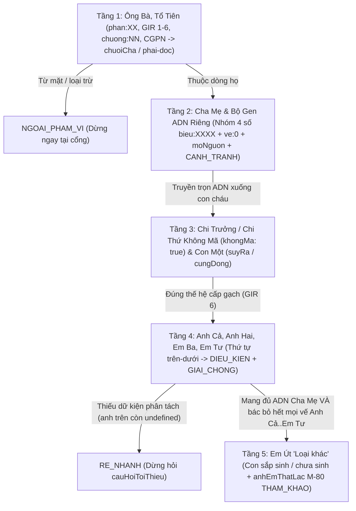

# Skill `doc-tron-nhom` — Đọc Trọn Nhóm 4 Số Theo ADR-0008 (M-81)

## 1. Mục đích, Phạm vi & Quy trình Một Lượt (ADR-0008)

Đọc và số hoá trọn vẹn **một gói nhóm 4 số** trong một lượt duy nhất (`goi-nhom.mjs` → `DIEU_KIEN`, `GIAI_CHONG`, `CANH_TRANH` → `bang-anh-em.mjs` → cổng `6–12` + `doBangAnhEm` → `so-diem.mjs`), làm tới đâu ăn điểm tới đó và không đọc lại nhóm đã `DONG`.

- **Nơi lưu:** `data/ho-so-ma/dieu-kien/<ma-chuong>.jsonl` (`DIEU_KIEN`, `GIAI_CHONG`, `CANH_TRANH`) và `data/ho-so-ma/bang-anh-em/<ma-chuong>.jsonl` (máy sinh qua `scripts/ho-so-ma/bang-anh-em.mjs`, không viết tay).
- **Nhánh & Worktree:** Làm việc trên worktree cô lập `/Users/ozvietnamdesktop/Documents/Claude/Projects/hs-code-api-wt/<slug>` với nhánh `agy/...` tách sạch từ `origin/main`.
- **An toàn:** Không sửa đường khách L1 (`api/`, `lib/`, `data/prompts/`, `lib/llm-tier.js`, `lib/llm.mjs`, `lib/ho-so-ma/ghep.js`), không sửa bản ghi dữ liệu cũ trong `data/ho-so-ma/` hay `data/ho-so/ranh-gioi/`, không đưa dữ liệu riêng tư (`data/oz-export/*`, `oz-gold*`, `.env`, `.keys/`) hay tiền lệ `tb:` vào điều kiện, tuyệt đối không chạy `gh pr merge` hay push thẳng lên `main`.
- **Chuẩn sạch mã dùng thẳng cho đo mù (`#2410` · `#2429`):** Toàn bộ tài liệu skill này viết 100% bằng luật chung và ký hiệu trừu tượng (`bieu:XXXX`, `bieu:XXXXXX`, `chuong:NN`, `phan:XX`, `Anh A` / `Anh B`), không chứa bất kỳ mã HS cụ thể nào để luôn nạp trực tiếp vào phiên kiểm định đo mù mà không cần gọt tay.

### Quy trình 9 bước một lượt cho một nhóm 4 số

1. **Lấy việc từ hàng đợi `so-diem.mjs --hang-doi`:** Chỉ nhận nhóm `CHUA`. Nhóm `DONG` không soạn lại. Nhóm `DO` chỉ sửa đúng bản ghi bị cổng chỉ ra hoặc đúng các nút trong `nutCanMoLai` khi vân tay câu luật đổi. Không cho mô hình phụ tự soạn lại các nhóm chuẩn tự kiểm hoặc các nhóm đang dùng làm tập kiểm định đo mù theo `#2410` (phép đo mù chạy cô lập với gói `goi-nhom.mjs` không đọc repo).
2. **Dựng gói đọc trọn nhóm (`goi-nhom.mjs --nhom <nhom-4-so>`):** Gói gồm cây biểu thuế đầy đủ (`cayBieu`), gia đình anh em (`nhomAnhEm`), luật nền Phần/Chương/Phân chương/nhóm/phân nhóm/SEN (đã loại bỏ `WCO`, `PHAN_BIET`, `PHAN_BIET_NGHIA` và `tb:`), cạnh loại trừ vào/ra (`loaiTru`), hồ sơ M-72..M-75 sẵn có (`NGUONG`, `DINH_NGHIA`, `CHI_LIET_KE`), và mục cạnh tranh từ `docs/mong/the/M-81-canh-tranh.md`. Nhóm quá dài tự tách `goiCon` theo phân nhóm 6 số nhưng vẫn giữ trọn chuỗi cha và anh em cùng cấp.
3. **Dựng cây cấp gạch đầy đủ:** Giữ nguyên mọi dòng trung gian không mã (`khongMa: true`, ký hiệu `bieu:XXXXXXN`). Với chuỗi con một (`suyRa: true` / `cungDong`, ví dụ chuỗi `bieu:XXXX -> bieu:XXXXXX -> bieu:XXXXXXXX`), chỉ cần đặt `DIEU_KIEN` / `CANH_TRANH` ở một nút đại diện trong chuỗi (ưu tiên nút cha 4/6 số), Cổng 6 & 12 tự đi theo toàn chuỗi `cungDong` không cần lặp bản ghi. Dòng `"Loại khác"` thuần (`loaiKhac: true`) không viết `DIEU_KIEN`; dòng `"Loại khác, ..."` có vế điều kiện thêm (`loaiKhacCoVe: true`) bắt buộc viết đủ chuỗi phủ định các anh trước và điều kiện của vế thêm.
4. **Tách `DIEU_KIEN` nguyên tử cho mọi nút có tên (`id: hs:<nut>:81NN`):**
   - **Mỗi câu hỏi — một điều kiện nguyên tử:** Không gộp nhiều mệnh đề độc lập vào chung một `cauHoi`.
   - `ve` (số nguyên `>= 0`): `;` ngoài ngoặc hoặc `hoặc` phân nhánh độc lập ⇒ tăng `ve` (`1, 2, ...`); `và` ⇒ cùng `ve`; **`ve: 0`** ⇒ điều kiện chung áp lên mọi vế của nút (chỉ dùng cho mệnh đề ở Chú giải Phần/Chương/Phân nhóm, danh sách loại trừ đứng ngoài mọi mục của chú giải nhóm, hoặc câu `"trừ…"` áp chung cả danh sách khi đã chứng minh không loại hàng mà một vế khác hay dòng biểu con ghi đích danh; câu loại trừ đứng bên trong mục `(A), (B)…` hoặc `(I), (II)…` của chú giải nhóm chỉ gắn vào đúng `ve` mà mục đó giải thích — xem Luật 3; nút có tên tách `;` vẫn phải đủ các `ve >= 1`).
   - `phu`: `true` cho mệnh đề phủ định/loại trừ (`"trừ..."`, `"không kể..."`, `"không phải..."`, `"không bao gồm..."`, và điều kiện phủ định anh đứng trước tại nhánh phần bù).
   - `kieu`: `CO_KHONG` (cấm `nguong`, `tap`, `tapDu`, `tapDuNguon`, `tapDuTrich`, `tapDuNguonVanTay`, `truc`, `daTri`; dùng cho mệnh đề có/không và cặp anh em chia đôi nhị phân đối xứng có/không dùng chung một `cauHoi` với `phu: false` / `phu: true` để `laPhuCuaNhau` nhận theo cấu trúc); `SO` (bắt buộc trỏ `nguong` = `id` `NGUONG` M-74, không lặp số, cấm `tap`, `tapDu`, `tapDuNguon`, `tapDuTrich`, `tapDuNguonVanTay`, `truc`, `daTri`); `GIA_TRI` (bắt buộc `truc` cục bộ trong gia đình anh em + `tap`, cấm `nguong`; đặt `daTri: true` khi một món hàng có thể mang nhiều giá trị cùng lúc trên trục đó, mặc định `false` đơn trị; khi các anh em phủ kín một trục đơn trị `!daTri` mà không lấy miền từ `tap` của nút cha thì khai tường minh `tapDu` = mảng đầy đủ các giá trị của `truc` — một lần ở điều kiện nút cha hoặc đồng nhất cả `tapDu` lẫn `tapDuNguon` trên mọi anh em cùng trục — **bắt buộc kèm `tapDuNguon` và `tapDuTrich` nguyên văn** cùng `tapDuNguonVanTay` sha256 câu nguồn trỏ câu chú giải/quy tắc trên đường đi hoặc chính lời văn nút cha làm căn cứ miền đóng, **trong đó mỗi giá trị của `tapDu` bắt buộc xuất hiện nguyên văn trong ít nhất một `tapDuTrich`**, cấm trích vòng tròn cây con bên dưới anh em con `bieu:`/`sen:`, cấm `tb:`/`wco:`, để Cổng 4 & 5 kiểm trích/vân tay và Cổng 7 kiểm `∪ tap = tapDu` bằng phép so tập thuần cấu trúc).
   - `mo`: `DINH_NGHIA_LUAT` và `MO_TA_HUONG_DAN` bắt buộc kèm `moNguon` (`RE_CAU` hợp lệ trong kho luật gốc hoặc mảng id, kể cả dẫn chiếu chéo Phần/Chương, cấm `tb:`); tuỳ chọn `moNguonVanTay` (sha256 hoặc `{ [id]: sha256 }`) do `tach-dieu-kien.mjs` tự gắn để `so-diem.mjs` phát hiện đổi chữ câu định nghĩa kể cả khi chưa có bản ghi `DINH_NGHIA`; `NGUONG` và `NGHIA_THUONG` cấm `moNguon`.
   - `nguon`, `trich`, `vanTay`: trích chuỗi con nguyên văn của câu `nguon` trong gói (`L.cau`), `vanTay = sha256(chu)`.
5. **Xét chồng từng cặp anh em cùng cấp & lập `GIAI_CHONG` (Cổng 8 `CHỒNG`):** Với mọi nút cha (đặc biệt nhóm lớn `> 20` dòng), liệt kê đầy đủ mọi cặp `(Anh A, Anh B)` có tên cùng cấp gạch để xét rời/chồng. Với cặp có thể cùng thoả trên một món hàng, lập `GIAI_CHONG` (`TRU` | `QUY_TAC_3` | `CHU_GIAI` | `NGUONG`) kèm trích luật nguyên văn. Lưu ý: Cổng 8 chỉ chứng minh tự rời nhau cho hai điều kiện `GIA_TRI` dương khi cùng `truc`, tập `tap` không giao, **cả hai đều đơn trị (`!daTri`) VÀ trục có `tapDu` kèm `tapDuNguon` + `tapDuTrich` hợp lệ** (hoặc dùng cặp `phu` bù đúng cấu trúc / khoảng `SO` rời nhau). Nếu có `daTri: true`, thiếu `tapDu`, hoặc `tapDu` thiếu nguồn hợp lệ, Cổng 8 gắn `CHUA_CHUNG_MINH_TACH` (ưu tiên xếp các cặp cùng trục lên đầu danh sách cảnh báo, in trọn vẹn không cắt dòng) cho tới khi có `tapDu` đủ nguồn hoặc `GIAI_CHONG` trích luật.
6. **Lập đầy đủ `CANH_TRANH` (Cổng 12 `BÙ`):** Với mọi nút mang cụm `"chưa được chi tiết hoặc ghi ở nơi khác"` hoặc khi gói đọc có mục cạnh tranh / ranh giới loại trừ sang nơi khác, bắt buộc điền đủ `CANH_TRANH` với `nhomCanhTranh` là định danh nút hợp lệ trong kho luật (`bieu:XXXX`, `chuong:NN`, `phan:XX`).
7. **Rút ca thử từ ví dụ chú giải / SEN & kiểm định tuyến `doBangAnhEm` (Cổng 10 `DÒ`):** Kiểm đủ 3 loại kết quả (`VE_DONG` / `DICH`, `RE_NHANH` khi thiếu dữ kiện — không nhảy cóc qua anh em đang `undefined`, `NGOAI_PHAM_VI` khi bị `ve: 0` hoặc `chuoiCha` loại ra) và không nổ `CHONG_LAP`. Khi tên nhóm có chữ định tính chỉ gắn với một vế, bộ ca thử bắt buộc có ca cho hàng không mang chữ định tính đó đi qua các vế/dòng con khác không có chữ đó để kiểm chứng `ve: 0` không loại nhầm.
8. **Kiểm kê `NGHIA_THUONG` (Cổng 11 `MỞ`):** Chỉ dùng khi đã tra hết gói đọc mà thực sự không có câu định nghĩa hay hướng dẫn; đếm trung thực (không ép giả về `0`), mỗi bản ghi có `cauHoi` nguyên tử một dòng `<= 300` ký tự để dừng hỏi ở vùng biên.
9. **Chạy cổng & nộp bài sạch:** Chạy `bang-anh-em.mjs`, `khuon.mjs`, `cong.mjs --pham-vi <nhom-4-so> --chi-trong --cong 6..12`, `so-diem.mjs --kiem-nhom <nhom-4-so>`, `oz-pr-auditor`, rồi mới mở/cập nhật PR (tuyệt đối không bóp công thức luật để lách cổng, tuyệt đối không chạy `gh pr merge` hay push thẳng lên `main`).

---

## 1b. Học Thuyết "Mỗi Nhóm 4 Số Là Một Gia Đình" (Ánh Xạ 5 Tầng Huyết Thống Sang M-81 & M-80)

Toàn bộ cơ chế M-81 (`ADR-0007`, `ADR-0008`, `ADR-0009`) và `M-80` (`#2404`) vận hành theo học thuyết nghiệp vụ cốt lõi của CEO Anh Thắng: **mỗi nhóm 4 số không phải những dòng rời rạc, mà là một Gia Đình huyết thống 5 tầng khép kín**. Ong đọc trọn nhóm bắt buộc tư duy đúng từ trên xuống dưới theo sơ đồ gia phả sau:



### Tầng 1 — Ông Bà, Tổ Tiên (`phan:XX` & `chuong:NN` → `chuoiCha` / `phai-doc`)
- Mỗi gia đình 4 số sinh ra trong một dòng họ lớn gồm **Chú giải Phần (`phan:XX`), 6 Quy tắc tổng quát (`GIR 1–6`), Chú giải Chương (`chuong:NN`) và Chú giải Phân nhóm**.
- Con cháu trong nhà bắt buộc tuân **gia pháp Ông Bà** trước tiên:
  - Nếu Ông Bà viết câu từ mặt (mệnh đề loại trừ đẩy hàng sang nhóm `bieu:YYYY` hoặc chương `chuong:MM` khác, hoặc quy tắc ưu tiên nhóm định danh cụ thể hơn) → sinh điều kiện loại trừ `phu: true` (`ve: 0`) để kết luận **`NGOAI_PHAM_VI`** ngay từ cổng, tuyệt đối không xét xuống phân nhóm bên dưới.
  - Mọi quy tắc tầng Phần/Chương về **vật liệu chiếm khối lượng ưu thế, cộng gộp khối lượng theo chương trước khi chọn vật liệu trội, hàng hỗn hợp, hoặc chức năng chính của tổ hợp máy/hàng đa chức năng** phải được đọc và áp dụng ở ngay Tầng 1 trước khi định kiểu trục cho các dòng con.
  - Khi tài liệu hướng dẫn cấp thấp (như SEN hoặc chú giải chi tiết) mâu thuẫn trực tiếp với Chú giải Phần/Chương hoặc lời văn dòng biểu (ví dụ câu SEN ghi lệch loại nguyên lý so với tiêu đề cha trực tiếp, hoặc liệt kê mặt hàng đã bị Chú giải Phần/Chương loại trừ), **gia pháp Ông Bà (văn bản pháp lý cao hơn) luôn thắng**; ong giữ đúng luật biểu/chú giải pháp lý và ghi rõ vào mục "điểm không chắc", cấm tự sửa chữ luật.

### Tầng 2 — Cha Mẹ & Bộ Gen ADN Riêng (`bieu:XXXX` → `DIEU_KIEN` của `bieu:XXXX` + `ve: 0` + `moNguon` + `CANH_TRANH`)
- Mỗi nhóm 4 số (`bieu:XXXX`) là **một gia đình độc lập mang Bộ Gen ADN riêng** (`DIEU_KIEN` tại `bieu:XXXX` + các điều kiện ngoại lệ/ràng buộc chung `ve: 0` + định nghĩa gốc `moNguon`).
- **Quy luật di truyền bắt buộc:** Mọi người con trong nhà (phân nhóm 6 số, chi trung gian không mã, dòng 8 số, kể cả Em Út `"Loại khác"`) đều **di truyền trọn vẹn 100% Bộ Gen ADN của Cha Mẹ và Ông Bà** (`chuoiCha`). Không người con nào được phép trái ADN Cha Mẹ.
- **Gia đình mang họ *"chưa được chi tiết hoặc ghi ở nơi khác"* hoặc có ranh giới giao thoa:** Phải đối chiếu Bộ Gen ADN với các **gia đình hàng xóm chuyên biệt hơn** thông qua bản ghi `CANH_TRANH` (Cổng 12 `BÙ`) dùng định danh nút chuẩn (`bieu:XXXX`, `chuong:NN`, `phan:XX`), xét đủ cả chiều bị nhóm khác hút đi lẫn chiều nhóm khác loại trừ đẩy về.
- **Gia đình hoặc nhánh kiểu bộ phận (nhóm bộ phận chuyên trách hoặc phân nhóm `"- Bộ phận"`):** Bộ Gen ADN là **điều kiện kép**: (1) thuộc đối tượng máy/thiết bị/phương tiện/hàng hoá đích (*"chỉ dùng hoặc chủ yếu dùng"* theo Chú giải Phần/Chương tương ứng), **VÀ** (2) vượt qua đầy đủ hàng rào loại trừ `phu: true` (`ve: 0`) của Phần/Chương (không phải bộ phận công dụng chung bị loại trừ, không thuộc danh mục loại trừ của Chú giải Phần/Chương, và bản thân không phải mặt hàng đã được mô tả cụ thể ở một nhóm riêng).

### Tầng 3 — Chi Trưởng / Chi Thứ Trung Gian Không Mã (`khongMa: true`) & Con Một (`suyRa: true` / `cungDong`)
- Các dòng tiêu đề gạch ngang trung gian không mang mã số (`khongMa: true`, ký hiệu `bieu:XXXXXXN`, ví dụ dòng tiêu đề `- - Nhóm thiết bị chuyên dụng:` hay `- - Loại khác:` có các dòng con bên dưới) là **các nhánh chi trong gia phả** — bắt buộc giữ nguyên và gắn đủ `DIEU_KIEN` (hoặc chuỗi phủ định các chi đứng trước nếu là chi `"- Loại khác:"`) để truyền trọn gen của chi xuống các cháu, tuyệt đối không cắt bỏ làm đứt phả hệ.
- Với **con một** (`suyRa: true` / `cungDong`, ví dụ chuỗi đơn nhánh từ 4 số xuống 6 số hoặc 8 số `bieu:XXXX -> bieu:XXXXXX -> bieu:XXXXXXXX`), chỉ đặt điều kiện một lần ở nút cha đại diện để con kế thừa nguyên vẹn qua `cungDong`, không sinh bản ghi trùng lặp.

### Tầng 4 — Anh Cả, Anh Hai, Em Ba, Em Tư Theo Thứ Tự Trên–Dưới (`GIR 6`, `DIEU_KIEN`, `GIAI_CHONG`)
- **Chung Cha Mẹ, chung Ông Bà, đúng thế hệ cấp gạch (`GIR 6`):** Chỉ so sánh ngang hàng các anh em cùng một cấp gạch dưới cùng một cha — tuyệt đối cấm đem chú 1 gạch đọ thẳng với cháu 2 gạch.
- **Căn cước từng người con (`DIEU_KIEN`):**
  - Tách nguyên tử từng mệnh đề và tách đủ mọi vế `HOẶC` (`ve: 1, 2...` theo dấu `;`, chữ `"hoặc"` nối hai nhánh bản chất hàng độc lập, hoặc cụm `"kể cả"` mở rộng thêm đối tượng ngoài vế chính; ngược lại, giữ chung một vế khi `"hoặc"` chỉ nối các giá trị trên cùng một `truc` hoặc khi `"kể cả"` chỉ minh hoạ hình thức/nội hàm của chính đối tượng trong vế).
  - Các điều kiện trong cùng một `ve` kết hợp bằng `VÀ`; mệnh đề loại trừ (`"trừ..."`, `"không kể..."`) đặt `phu: true` (`ve: 0` nếu áp chung toàn nút, hoặc gắn đúng vào các vế thuộc đoạn trước/sau dấu `;` mà mệnh đề đó chi phối — cấm áp tràn sang vế độc lập bên kia dấu `;`).
  - Khi các anh em phân tách theo cùng một thuộc tính (vật liệu, chủng loại, công dụng, trạng thái lắp ráp, đối tượng phục vụ, dạng bào chế…), bắt buộc biểu diễn bằng `kieu: "GIA_TRI"` có `truc` cục bộ của gia đình anh em đó.
  - Nhánh phần bù có tên mang chữ `"khác"` (ví dụ *"Thiết bị cơ khí khác"*, *"Từ các vật liệu khác"*, hay dòng lai *"Loại khác, hoạt động bằng điện"*) bắt buộc biểu diễn bằng chuỗi điều kiện phủ định `phu: true` khớp cấu trúc với từng anh đứng trước (kết hợp điều kiện dương của vế thêm nếu có, hoặc kèm `GIAI_CHONG` `cach: "TRU"`), cấm liệt kê đóng danh sách mở.
- **Thứ tự TRÊN – DƯỚI giữa các anh em (`GIAI_CHONG` — Cổng 8 `CHỒNG` & `ADR-0009`):**
  - Anh đứng trên thường cụ thể hơn hoặc có ranh giới ưu tiên, còn anh đứng dưới mang tính phần bù hoặc xếp sau theo quy tắc phân loại.
  - **Phần bù anh em ở Cổng 7 & 8 chỉ xét theo cấu trúc, cấm so chuỗi con `trich` (`ADR-0005` · `ADR-0009` Điểm 1):** Ví dụ `Anh A` mang `trich: "vật liệu A"` và `Anh B` mang `phu: true, trich: "vật liệu A gia cố"` **KHÔNG phải** phần bù của nhau (vì món hàng *"vật liệu A không gia cố"* thoả đồng thời cả hai!). Hai điều kiện chỉ bù nhau khi **cùng `kieu`** + **cùng `truc` đơn trị (`GIA_TRI`)** / **cùng `nguong` (`SO`)** / **cùng `cauHoi` (`CO_KHONG`)** + **tập `tap` hoặc khoảng bằng hệt nhau** + **`phu` ngược dấu**.
  - **Giao khoảng số trên `SO` = `VUNG_CHONG` chặn cứng (`ADR-0009` Điểm 3):** Hai anh em đơn điều kiện `SO` (không `phu`) cùng đại lượng vật lý mà khoảng số giao nhau là vùng chồng do máy chứng minh trực tiếp (mạnh hơn phiếu mô hình) — cả `bang-anh-em` lẫn Cổng 8 đều gắn cờ **`VUNG_CHONG` chặn cứng** cho tới khi có `GIAI_CHONG` trích luật phân xử thứ tự trên–dưới.
  - **Trục đa trị (`daTri: true` — `ADR-0009` Điểm 2):** Khi một món hàng có thể mang đồng thời nhiều giá trị trên cùng trục (như sản phẩm chứa nhiều hoạt chất/thành phần, máy đa công dụng, hoặc hàng pha trộn nhiều vật liệu trước khi áp quy tắc chiếm trội), khác tập `tap` **không tự chứng minh rời nhau** (`CHUA_CHUNG_MINH_TACH`), bắt buộc phân xử thứ tự trên–dưới bằng `GIAI_CHONG` trích luật nguyên văn (`TRU`, `CHU_GIAI`, `NGUONG`, hoặc `QUY_TAC_3` `3a -> 3b -> 3c`).

### Tầng 5 — Em Út `"Loại khác"` = Người Con Sắp Sinh, Chưa Sinh, Hoặc Thất Lạc (Cổng 6, 7, 9, 10 & `M-80`)
- **Công thức huyết thống đóng kín (`bang-anh-em@1`):**
  $$\text{"Loại khác" của Cha } P = \text{ADN}(\text{Cha } P \land \text{Ông Bà}) \land \neg(\text{Anh Cả} \lor \text{Anh Hai} \lor \dots \lor \text{Em Tư})$$
  Một món hàng chỉ được bước vào phòng Em Út `"Loại khác"` khi thoả đồng thời: **(1) Mang đủ Bộ Gen ADN của Cha Mẹ & Ông Bà**, VÀ **(2) Đã kiểm hết mọi vế của tất cả các anh chị có tên đứng trên mà đều trả lời `"KHÔNG"` (`false`)**.
- **Người con SẮP SINH / CHƯA SINH (Hàng công nghệ mới, tương lai mới ra đời):** Mang đúng ADN của gia đình nhưng lúc ban hành biểu thuế thế giới chưa chế tạo ra hoặc chưa tách dòng riêng. Do đó **TUYỆT ĐỐI CẤM đóng kín `"Loại khác"` bằng danh sách tên sản phẩm cố định** (làm vậy sẽ đuổi oan người con sắp sinh); chỉ đóng bằng công thức tiêu chí phủ định các anh trên + giữ trọn ADN Cha Mẹ.
- **Người con THẤT LẠC (`M-80` — `#2404`):** Là những người con đã có tên riêng trên thế giới (biểu thuế 8–10 số của ASEAN AHTN, EU CN, Mỹ HTS, Nhật, Hàn, Trung Quốc; bản sửa đổi danh mục HS mới; ý kiến phân loại WCO) nhưng biểu thuế Việt Nam chưa gọi tên riêng nên đang ở chung phòng `"Loại khác"`. Ở Lớp 7 (`M-80`), ghi nhận vào ô `anhEmThatLac` mang nhãn **`THAM_KHAO`** để trợ lý nhận diện người nhà ngay, nhưng **căn cứ pháp lý chốt mã vẫn bắt buộc chạy qua đúng công thức `ADN Cha Mẹ + bác bỏ từng Anh Cả..Em Tư`** (cấm lấy tên tham khảo nước ngoài làm căn cứ thay chữ luật Việt Nam).
- **Cấm biến phòng Em Út thành "thùng rác đoán mò" (Cổng 9 `HỎI`, Cổng 10 `DÒ` & `doBangAnhEm`):** Khi bất kỳ vế nào của các anh đứng trên còn thiếu dữ kiện (`undefined`), `doBangAnhEm` bắt buộc dừng tại **`RE_NHANH`** và trả `cauHoiToiThieu` để hỏi đặc tính thực trên hàng — tuyệt đối cấm nhảy cóc qua anh em đang `undefined` hay tự đoán `"không"` để đẩy hàng xuống anh dưới hoặc `"Loại khác"`.
- **Gia đình không sinh `"Loại khác"` (Cổng 7 `PHỦ` & `ADR-0009` Điểm 5 & 6):** Khi dưới một nút cha không có dòng `"Loại khác"`, tổng điều kiện của Anh Cả..Em Tư phải phủ kín 100% ADN của Cha Mẹ theo cấu trúc: cặp nhị phân có/không dùng `CO_KHONG` chung `cauHoi` ngược `phu`; trục số `SO` nối tiếp kín dải; trục `GIA_TRI` phủ hết `tap` do mọi vế nút cha khoá, hoặc trên trục đơn trị (`!daTri`) khai tường minh `tapDu` kèm `tapDuNguon` + `tapDuTrich` nguyên văn (trích câu chú giải/quy tắc hoặc lời văn nút cha mà **từng phần tử trong `tapDu` đều xuất hiện nguyên văn trong `tapDuTrich`**, cấm trích vòng tròn dòng biểu/SEN của cây con anh em; Cổng 4 & 6 kiểm trích, thiếu nguồn hoặc thiếu giá trị trong câu trích → Cổng 7 báo `HO_PHU` đưa vào gói người làm nghề duyệt) để máy kiểm `∪ tap = tapDu`; hoặc theo **danh sách đóng hai quy ước cấu trúc dòng biểu thuế** (không đọc `tap`, cấm tự mở rộng): (a) dòng `"Loại khác"` / `"… khác"` là phần bù của các anh em có tên, (b) nhánh `"Bộ phận (và phụ kiện)"` đi cùng nhánh phần bù nguyên chiếc chỉ được chứng minh phủ khi lời văn một nút trên chuỗi cha (từ nút cha tới tên Chương, không lấy tên Phần) chứa nguyên văn `"bộ phận của nó/chúng"` hoặc `"bộ phận và phụ kiện của nó/chúng"` kèm `id` câu căn cứ lưu vào `vanTayCau`. Cổng 7 không đoán nghĩa chữ trong `tap` (hai dòng `GIA_TRI` viết chữ đối nhau mà thiếu `tapDu` hoặc thiếu căn cứ nguyên văn vẫn báo `HO_PHU`).

---

## 2. 7 Luật Chung Bắt Buộc Khi Soạn Gói Nhóm 4 Số (Từ Kiểm Định Đo Mù)

Bảy luật dưới đây đúc kết từ các vòng kiểm định đo mù của QT (`#2410#issuecomment-7217142503`), áp dụng bắt buộc cho **mọi** gói nhóm 4 số:

### Luật 1 — Một câu hỏi — một điều kiện nguyên tử
- **Quy tắc:** Tuyệt đối không gộp nhiều mệnh đề hoặc điều kiện nguyên tử độc lập (ví dụ gộp *loại hàng + cách đóng gói + đối tượng dùng*, hoặc gộp *điều kiện phủ định loại trừ + chủng loại phương tiện/thiết bị*) vào chung một `cauHoi` hay một bản ghi `DIEU_KIEN`.
- **Cách làm đúng:** Tách mỗi mệnh đề kiểm chứng độc lập thành một bản ghi `DIEU_KIEN` riêng (giữ cùng số `ve` khi kết hợp bằng `VÀ`, tách khác `ve` khi phân nhánh `HOẶC`) sao cho người khai/máy có thể trả lời dứt khoát từng điều kiện một mà không bị vướng câu hỏi kép.

### Luật 2 — Thuộc tính chung của gia đình anh em bắt buộc là `GIA_TRI` có `truc`
- **Quy tắc:** Khi các anh em dưới cùng một cha phân tách theo cùng một thuộc tính nhiều giá trị (như `"vật liệu"`, `"chủng loại"`, `"công dụng"`, `"trạng thái lắp ráp"`, `"đối tượng phục vụ"`, `"dạng bào chế"`, `"loại dòng điện"`…), bắt buộc dùng `kieu: "GIA_TRI"` kèm tên `truc` cục bộ thống nhất trong gia đình anh em đó và mảng `tap` trích nguyên văn giá trị (gắn `daTri: true` nếu một món hàng có thể đồng thời mang nhiều giá trị trên trục đó; gắn `tapDu` kèm `tapDuNguon` + `tapDuTrich` nguyên văn từ câu chú giải/quy tắc hoặc lời văn nút cha — trong đó **mỗi phần tử của `tapDu` đều phải xuất hiện nguyên văn trong `tapDuTrich`**, cấm trích vòng tròn dòng biểu/SEN của cây con anh em — khi trục đơn trị `!daTri` có miền giá trị đóng chứng minh được từ luật để Cổng 4 kiểm trích, Cổng 7 kiểm phủ kín `∪ tap = tapDu` và Cổng 8 chứng minh rời nhau; nếu trục chưa có câu luật liệt kê đủ các giá trị đóng miền, tuyệt đối không khai `tapDu` gượng ép mà để nguyên để Cổng 7 gắn `HO_PHU` trung thực đưa vào gói người duyệt và Cổng 8 giữ ở `CHUA_CHUNG_MINH_TACH`). Riêng cặp anh em chỉ chia đôi nhị phân có/không đối xứng trên một mệnh đề đơn lẻ mà không có câu chú giải liệt kê đóng miền thì biểu diễn bằng `CO_KHONG` chung `cauHoi` với `phu: false` / `phu: true` (không tự gom hợp các `tap` của anh em làm `tapDu` không nguồn).
- **Lỗi cấm:** Tuyệt đối cấm hạ trục nhiều giá trị `GIA_TRI` xuống `CO_KHONG` làm mất trục phân loại chung rồi viết hàng loạt `GIAI_CHONG` thừa để lấp chỗ trống, và cấm bóp méo công thức luật để lách cổng kiểm.

### Luật 3 — Đầy đủ chuỗi phủ định `phu: true` và phạm vi câu loại trừ của chú giải nhóm
- **Quy tắc:** Mọi dòng `"Loại khác"` có điều kiện thêm (`loaiKhacCoVe: true`), mọi nhánh phần bù có tên (`"… khác"`), và **mọi mệnh đề loại trừ ở tên nhóm, Chú giải Phần, Chú giải Chương, Chú giải Phân nhóm hoặc Chú giải nhóm** đều bắt buộc sinh đầy đủ các bản ghi `DIEU_KIEN` mang `phu: true`, đồng thời tuân thủ nghiêm ngặt phạm vi `ve`:
  - **Chú giải Phần / Chương / Phân nhóm hoặc câu loại trừ chung ngoài mọi mục:** Đặt `ve: 0, phu: true` khi mệnh đề thực sự áp chung lên toàn bộ nút/nhóm để chặn `NGOAI_PHAM_VI` ngay từ đầu.
  - **Phạm vi câu loại trừ của chú giải nhóm (3 mệnh đề bắt buộc):**
    1. Câu `"nhóm này loại trừ / không bao gồm"` đứng trong một mục `(A), (B)…` hoặc `(I), (II)…` của chú giải nhóm chỉ chắc chắn chi phối vế tên nhóm mà mục đó giải thích. Chỉ nâng lên `ve: 0` khi câu đứng ngoài mọi mục, hoặc khi đã chứng minh nó không loại hàng mà một vế khác hay một dòng biểu con ghi đích danh.
    2. Câu loại trừ theo thuộc tính chung (nơi dùng, quy mô, đối tượng dùng…) đúng bằng phủ định của chữ định tính mà chỉ một vế mang thì gắn `phu: true` vào đúng vế đó, hoặc ghi `CANH_TRANH`; **cấm `ve: 0`**.
    3. Chữ biểu thắng vị trí câu trong chú giải chi tiết: `ve: 0` nào làm một dòng con mất hàng của chính nó là sai phạm vi.
  - **Nhánh phần bù có tên hoặc dòng lai `"Loại khác, ..."`:** Sinh đủ các điều kiện `phu: true` khớp đúng cấu trúc (`kieu`, `truc`/`nguong`/`cauHoi`, `tap`/khoảng) bác bỏ từng anh đứng trước, kết hợp với điều kiện dương của chính nhánh đó.

### Luật 4 — Nhóm lớn (`> 20` dòng) phải lập danh sách mọi cặp anh em cùng cấp rồi xét chồng từng cặp
- **Quy tắc:** Với các nhóm lớn (`> 20` dòng biểu), tuyệt đối không duyệt nhẩm bằng mắt gây bỏ sót cặp chồng lấn. Với **từng nút cha** trong cây cấp gạch, phải lập danh sách vét cạn mọi cặp `(Anh A, Anh B)` có tên cùng cấp rồi kiểm chứng từng cặp rơi vào đúng một trong ba trạng thái:
  1. **Tự rời nhau theo cấu trúc máy kiểm được:** cùng `truc` đơn trị (`!daTri`) có `tapDu` kèm `tapDuNguon` + `tapDuTrich` hợp lệ và `tap` rời nhau, cùng đại lượng `SO` có khoảng không giao, hoặc cặp điều kiện `phu` bù nhau đúng cấu trúc.
  2. **Có giao nhưng phân xử được bằng luật:** lập ngay bản ghi `GIAI_CHONG` trích câu luật nguyên văn (`TRU` / `QUY_TAC_3` / `CHU_GIAI` / `NGUONG`) xác lập thứ tự ưu tiên giữa `Anh A` và `Anh B`.
  3. **Chồng thực sự chưa có câu luật phân xử:** giữ trung thực cờ `VUNG_CHONG` kèm mô tả mặt hàng cụ thể thoả đồng thời cả hai anh em, tuyệt đối không bịa `GIAI_CHONG` không có căn cứ.

### Luật 5 — `NGHIA_THUONG` chỉ dùng khi chữ thực sự không có định nghĩa/hướng dẫn trong gói đọc
- **Quy tắc:** Trước khi gán `mo: "NGHIA_THUONG"` cho bất kỳ điều kiện nào, bắt buộc tra soát vét cạn toàn bộ Chú giải Phần, Chú giải Chương, Chú giải Phân nhóm, Chú giải chi tiết nhóm/phân nhóm và SEN có trong gói đọc (`goi-nhom.mjs`) — kể cả câu dẫn chiếu chéo sang Phần/Chương khác.
- **Lỗi cấm:** Hễ gói đọc đã có câu định nghĩa pháp lý (`mo: "DINH_NGHIA_LUAT"` kèm `moNguon`) hoặc câu mô tả, liệt kê phạm vi, hướng dẫn kỹ thuật (`mo: "MO_TA_HUONG_DAN"` kèm `moNguon`), bắt buộc gắn đúng `mo` và `moNguon`, tuyệt đối không gán `NGHIA_THUONG` tràn lan do lười tra chú giải.

### Luật 6 — Áp Chú giải Phần/Chương về vật liệu chiếm ưu thế hoặc hàng hỗn hợp/đa chức năng trước khi xét xuống dòng
- **Quy tắc:** Trước khi thiết kế điều kiện cho các phân nhóm con, bắt buộc đọc các Chú giải Phần/Chương quy định cách quy đổi một mặt hàng phức hợp về một tiêu chí phân loại (như quy tắc chọn vật liệu chiếm khối lượng ưu thế, quy tắc cộng gộp tổng khối lượng các thành phần thuộc cùng một Chương trước rồi mới chọn thành phần trội trong Chương thắng, quy tắc chức năng chính của tổ hợp máy/thiết bị đa chức năng, hoặc quy tắc đặc tính cơ bản):
  - Nếu Chú giải Phần/Chương đã quy mặt hàng hỗn hợp về **một giá trị thắng duy nhất** trước khi bước xuống phân nhóm (như vật liệu chiếm ưu thế sau bước cộng gộp theo chương) → ghi rõ quy tắc quy đổi vào hướng dẫn/`moNguon` để xác định đúng bản chất đơn trị (`daTri: false`) của trục sau quy đổi.
  - Nếu ở cấp phân nhóm mặt hàng vẫn có thể đồng thời thoả nhiều nhánh mà Chú giải Phần/Chương chưa rút gọn thành một giá trị duy nhất → bắt buộc gắn `daTri: true` và lập `GIAI_CHONG` trích đúng câu luật phân xử (`CHU_GIAI`, `QUY_TAC_3`, `TRU`, `NGUONG`).

### Luật 7 — Luôn điền đầy đủ `CANH_TRANH` từ mục cạnh tranh và ranh giới loại trừ của gói đọc
- **Quy tắc:** Không bao giờ bỏ trống bản ghi `CANH_TRANH` khi nút mang cụm `"chưa được chi tiết hoặc ghi ở nơi khác"` hoặc khi gói đọc có mục cạnh tranh / câu loại trừ chỉ sang nhóm hoặc chương khác.
- **Ràng buộc khuôn:** Mọi phần tử trong mảng `nhomCanhTranh` bắt buộc là định danh nút hợp lệ trong kho luật (`bieu:XXXX`, `chuong:NN`, `phan:XX`), đi kèm phép thử phân biệt và trích dẫn câu luật nguyên văn (`nguon`, `trich`, `vanTay`); tuyệt đối không ghi tên nhóm bằng chữ tự do hay bỏ sót các nhóm cạnh tranh ngoài chương đã nêu trong gói đọc.

---

## 3. Bảng Soát Kỹ Thuật Cổng 6–12 & Định Tuyến `doBangAnhEm`

| Hạng mục kiểm soát | Chuẩn ĐÚNG cần đạt | Lỗi SAI bị trả thợ |
|---|---|---|
| **1. Định tuyến thực tế `doBangAnhEm`** | Mọi ca thử đi từ `bieu:XXXX` xuống đích cho đúng `DICH`, `RE_NHANH` (khi anh đứng trên còn `undefined`), hoặc `NGOAI_PHAM_VI` (khi vi phạm `chuoiCha` / `ve: 0`), `0` ca nổ `CHONG_LAP`; có ca cho hàng không mang chữ định tính của một vế đi qua các vế/dòng con khác mà không bị `ve: 0` loại nhầm. | Nhảy cóc qua anh đứng trên đang `undefined` để rơi thẳng xuống anh dưới hoặc `"Loại khác"`, để hai anh cùng `true` nổ `CHONG_LAP`, hoặc thiếu ca kiểm `ve: 0` loại nhầm vế khác. |
| **2. Tách vế `;`, `"hoặc"`, `"kể cả"` & phạm vi `ve: 0` chú giải nhóm** | Tách `ve` mới cho `;`, `"hoặc"` khác bản chất hàng, và `"kể cả"` mở rộng phạm vi ngoài vế chính; giữ chung 1 `ve` cho `"hoặc"` cùng một `truc` và `"kể cả"` chỉ nêu hình thức/nội hàm; câu `"trừ…"` sau `;` chỉ gắn vào các vế do đoạn đó chi phối; câu loại trừ đứng trong mục `(A), (B)…` / `(I), (II)…` của chú giải nhóm chỉ gắn vào vế mà mục đó giải thích, câu loại trừ theo thuộc tính chung là phủ định chữ định tính của riêng một vế thì gắn `phu: true` vào đúng vế đó hoặc ghi `CANH_TRANH` (chỉ nâng lên `ve: 0` khi đứng ngoài mọi mục hoặc chứng minh không loại hàng của vế khác / dòng biểu con; chữ biểu thắng vị trí câu chú giải). | Tách máy móc mọi chữ `"kể cả"` / `"hoặc"` thành vế rời; áp tràn câu `"trừ…"` sau `;` ngược sang vế độc lập trước `;`; hoặc nâng câu loại trừ của một mục `(A), (B)…` / `(I), (II)…` (nhất là loại trừ theo thuộc tính chung của riêng một vế) lên `ve: 0` làm dòng con mất hàng của chính nó. |
| **3. Bù cấu trúc, `tapDu` có nguồn & quy ước đóng biểu thuế ở Cổng 4, 7 & 8 (`ADR-0009` Điểm 1, 5, 6)** | Bù chỉ xét khi cùng `kieu`, cùng `truc` / `nguong` / `cauHoi`, tập/khoảng bằng nhau và `phu` ngược dấu; mọi `tapDu` trên trục `GIA_TRI` đơn trị (`!daTri`) bắt buộc kèm `tapDuNguon` (câu chú giải/quy tắc hoặc lời văn nút cha, cấm trích dòng biểu/SEN cây con anh em) + `tapDuTrich` nguyên văn chứa đầy đủ từng giá trị của `tapDu`; quy ước cấu trúc dòng biểu chỉ đóng ở 2 mục (`"Loại khác"`/`"… khác"` và nhánh `"Bộ phận (và phụ kiện)"` khi nút cha tới tên Chương có câu nêu nguyên văn bộ phận của nó/chúng lưu vào `vanTayCau`); thiếu căn cứ → Cổng 7 `HO_PHU` chuyển gói người duyệt, Cổng 8 `CHUA_CHUNG_MINH_TACH` xếp cặp cùng trục lên đầu; cặp nhị phân có/không (vd đã lắp ráp hoàn chỉnh vs chưa lắp hoàn chỉnh) dùng `CO_KHONG` ngược `phu`. | So chuỗi con `trich`, khai `tapDu` tự gom hợp `tap` anh em không nguồn, lấy tên chung nút cha làm `tapDuTrich` mà không chứa nguyên văn từng phần tử `tapDu`, tự thêm regex đoán chữ ngoài danh sách đóng, viết `GIA_TRI` hai chữ đối nhau mong Cổng 7 đoán chữ, hoặc giả định trục mở là tự rời nhau ở Cổng 8. |
| **4. Khoảng số `SO` giao nhau (`ADR-0009`)** | Hai anh em đơn điều kiện `SO` (không `phu`) cùng đại lượng có khoảng giao nhau gắn cờ `VUNG_CHONG` chặn cứng ở cả `bang-anh-em` và Cổng 8 cho tới khi có `GIAI_CHONG` trích luật. | Hạ xuống `CHUA_CHUNG_MINH_TACH` không chặn hoặc lặp lại con số vào `GIA_TRI` thay vì trỏ `nguong` M-74. |
| **5. Chống bóp công thức luật lách cổng** | Giữ trung thực cấu trúc pháp lý của từng dòng biểu và chú giải; nếu luật gốc có xung đột hoặc vùng chồng thật thì ghi nhận minh bạch bằng `VUNG_CHONG` / mục "điểm không chắc". | Cố tình hạ `GIA_TRI` xuống `CO_KHONG`, gộp ẩu điều kiện nguyên tử, đặt `truc` giả, hoặc gán `GIAI_CHONG` không có căn cứ luật chỉ để làm xanh cổng. |
| **6. Bảo toàn tuyệt đối phép đo mù (`#2410` · `#2429`)** | Giữ `doc-tron-nhom/SKILL.md` sạch 100% mã HS cụ thể và từ khoá tập mẫu để nạp trực tiếp vào mọi phiên đo mù cô lập (`goi-nhom.mjs`). | Đưa mã nhóm/phân nhóm thật hoặc ví dụ lộ đề vào `doc-tron-nhom/SKILL.md` làm ô nhiễm phép đo mù và phải gọt tay trước khi đo. |

---

## 4. Sổ Điểm Không Đọc Lại & Lệnh Tự Kiểm

- `so-diem.mjs` **không ghi tệp trạng thái riêng** — trạng thái `DONG` / `CHUA` / `DO` được tính tất định từ kho `data/luat-goc/` + `data/ho-so-ma/` và vân tay sha256 mọi câu luật trong gói:
  - **`DONG`**: có `DIEU_KIEN`, 0 lỗi khuôn, `bang-anh-em` qua cổng `6–12`, và vân tay mọi câu luật dẫn chiếu còn khớp.
  - **`CHUA`**: chưa có bản ghi nào của nhóm 4 số (`--hang-doi` chỉ phát nhóm `CHUA`).
  - **`DO`**: lỗi khuôn / trượt cổng `6–12` (`congLoi`) / vân tay câu luật đổi (`cauDoiVanTay`, chỉ mở lại đúng các nút trong `nutCanMoLai`).

```bash
# 1. Lấy hàng đợi nhóm CHUA (không đọc lại nhóm DONG)
node scripts/ho-so-ma/so-diem.mjs --hang-doi --chuong <ma-chuong> --gioi-han 10

# 2. Dựng gói đọc trọn nhóm 4 số (kể cả cây khongMa, suyRa, M-72..M-75, CANH_TRANH)
node scripts/ho-so-ma/goi-nhom.mjs --nhom <nhom-4-so> --tom-tat

# 3. Tách điều kiện nguyên tử trọn gói nhóm 4 số qua cổng OpenAI-compatible (cấu hình qua env/cờ, không cứng khoá/IP)
node scripts/ho-so-ma/tach-dieu-kien.mjs --nhom <nhom-4-so> --out data/ho-so-ma/dieu-kien/<ma-chuong>.jsonl

# 4. Sinh bảng anh em tất định & kiểm cổng 6–12 + sổ điểm
node scripts/ho-so-ma/bang-anh-em.mjs --chuong <ma-chuong> --ghi
node scripts/ho-so-ma/khuon.mjs
node scripts/ho-so-ma/cong.mjs --pham-vi <nhom-4-so> --chi-trong --cong 6..12
node scripts/ho-so-ma/so-diem.mjs --kiem-nhom <nhom-4-so>

# 5. So hai phiếu độc lập & chạy kiểm thử M-81
node scripts/ho-so-ma/so-phieu-dieu-kien.mjs --phieu-1 p1.jsonl --phieu-2 p2.jsonl --strict
node scripts/test-dieu-kien.mjs
node scripts/test-ho-so-ma.mjs

# 6. Đồng bộ và kiểm an toàn skill với plugin oz-orchestrator
node scripts/quan-ly-skill.mjs --dong-bo
node scripts/quan-ly-skill.mjs --kiem --bat-buoc-plugin
node scripts/test-quan-ly-skill.mjs
```
