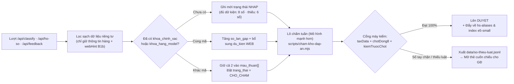

# Thiết kế Một trang — Kho đáp án khép vòng ("Cuốn sổ thứ tư", G5 · OZV-760)

- **Ngày:** 14/11/2026 · **Người viết:** GĐ `hs-code-api` · **Thẻ:** [OZV-760](/OZV/issues/OZV-760) (con của [OZV-754](/OZV/issues/OZV-754))
- **Đã tra trước khi thiết kế:** CodeGraph + `/paperclip/bin/hoi-tri-nho --thu-vien`, `nghien-cuu/RADAR.md` (mục *Hiểu hàng*, *Tra web*, *Tìm trong kho*, *Mô hình quyết định nhỏ*, *Chấm đáp án*), `erp-xnk` `docs/adr/ADR-034-vong-phan-hoi-hs-va-ma-chot-theo-don.md`, `lib/classify-cache.js`, `lib/b1b-web.js`, `lib/ho-so/api.js`, `api/feedback.js`, `lib/embed-pool.js`, `lib/hs-aliases.js`.

---

## 1. Số đo hiện trạng 7 ngày gần nhất & Kiểm chứng giả thuyết

### 1.1. Số đo đã có từ bản thật (`oz_gateway` + `hs-code-api`)
| Chỉ số | Giá trị đo thật | Nguồn / Bằng chứng |
|---|---|---|
| **Lượt phân loại 7 ngày** (`phan_loai_cong_viec`) | **463 lượt** (~**66,1 lượt/ngày**; 24h ngày 14/11 = **67 lượt**) | DB Cổng (`OZV-511`, QT đo 12/11) + Thực địa 14/11 |
| **Trùng y hệt theo băm hồ sơ (`bam_dau_vao` / `khoaCache`)** | **63/463 = 13,6%** (400 hồ sơ khác nhau; 61/63 nằm trong 24h). Trong 24h ngày 14/11: **13/67 = 19,4%** trả từ `classify_cache` | `OZV-511` + Thực địa 14/11 15:15 VN |
| **Trùng mặt hàng nhưng trượt `classify_cache` (mẫu 25 lượt mới nhất)** | **11/25 lượt (44,0%)** hỏi lặp cùng mặt hàng (5× bộ xếp hình 128 chi tiết, 4× hộp nhựa PP 2 khoá, 2× máy bơm ly tâm), nhưng chỉ **2/25 (8,0%)** trúng cache (`10ms`, `37ms`); **9/11 lượt lặp (81,8%) bị lọt** và phải chạy lại 36–228s | `/paperclip/du-lieu/chuyen-giao/ozv817-sql-1411.txt` |
| **Số lượt AI & tra web trung bình mỗi lượt không trúng kho** | **2–4 lượt LLM** (`understand` + `gir` + tối đa 1 vòng sửa `HS_MAX_VONG_SUA` + 1 vòng chạy lại `B1b`) + **0–1 lượt tra web** (`timWeb` SearXNG ~1s hoặc `webFacts` z.ai ~10s khi `NEED_FACTS`) | `lib/engine-loop.js:180-204,1467-1492`, `lib/b1b-web.js:49-158` |
| **Thời gian phản hồi** | Trúng `classify_cache`: **10–37 ms** · Gọi thẳng `/api/classify` (OZV-831): trung vị **11,85 s** · Qua Cổng (5 lượt gần nhất 14/11): trung vị **37,4 s** (24h cả chùm lỗi chiều 13/11: **123 s**) | `ozv817-sql-1411.txt`, `OZV-831` |

- **CẦN QT:** chạy truy vấn dưới đây trên Postgres `oz_gateway` để lấy đủ 3 số toàn cục 7 ngày (tỷ lệ trùng sau khi chuẩn hoá tên/hãng/model, số lời gọi AI trung bình, tỷ lệ gọi web B1b):
```sql
WITH raw AS (
  SELECT id, tao_luc, bam_dau_vao,
         lower(regexp_replace(unaccent(coalesce(dau_vao->>'tenHang', dau_vao->>'name', '')), '\s+', ' ', 'g')) AS ten_chuan,
         lower(trim(coalesce(dau_vao->>'brand', ''))) AS brand_chuan,
         lower(trim(coalesce(dau_vao->>'model', ''))) AS model_chuan
  FROM phan_loai_cong_viec
  WHERE loai = 'PHAN_LOAI' AND tao_luc >= now() - interval '7 days'
)
SELECT count(*) AS tong_luot_7d,
       round(count(*)::numeric / 7, 1) AS luot_moi_ngay,
       count(DISTINCT bam_dau_vao) AS so_bam_y_het,
       count(DISTINCT (ten_chuan, brand_chuan, model_chuan)) AS so_mon_chuan_hoa,
       round(100.0 * (count(*) - count(DISTINCT (ten_chuan, brand_chuan, model_chuan))) / NULLIF(count(*),0), 1) AS pct_lap_theo_mon
FROM raw;
```

### 1.2. Kiểm chứng 4 giả thuyết của QT tại mã nguồn
1. **`lib/classify-cache.js` chỉ khớp băm y hệt:** **ĐÚNG** (`lib/classify-cache.js:63-86`). `khoaCache` băm cả `{attrs, hoSoKhaiBao, tier, kenhGoi, noiBo}` và chỉ bật cho `serviceCaller(req) !== null` (`api/classify.js:166-176`). Cùng món hàng nhưng gọi từ kênh khác (`cong-oz` vs `erp-xnk` vs công khai), khác `tier`, hoặc viết khác 1 chữ đều trượt.
2. **Vòng học cũ chết:** **ĐÚNG**. `api/feedback.js:168-170` chỉ ghi vào tệp `/data/feedback.jsonl` (đang 0 byte); `lib/learned-corrections.js` chỉ nối vào `api/suggest.js` (động cơ `loop` ở `lib/engine-loop.js` không đọc) và phạt thô `-15` điểm theo mã `fromHs` cho mọi mặt hàng (`lib/learned-corrections.js:63-80`).
3. **`erp-xnk` `ADR-034` chưa khép vòng:** **ĐÚNG**. `erp-xnk` đã có `hs-feedback.ts` gọi `POST /api/feedback` khi nhân viên chốt mã, nhưng `0/245` đơn có `hsCodeChosen` và phía `hs-code-api` chưa nối `/api/feedback` vào Postgres hay động cơ `loop`.
4. **Dữ kiện tra web B1b dùng xong là bỏ:** **ĐÚNG** (`lib/b1b-web.js:131-158`). Đoạn trích và URL tìm được từ SearXNG / z.ai (`hint.cauTraLoi`, `hint.nguon`) chỉ ghép tạm vào `tenHang` để chạy lại 1 lượt rồi trả về response, không lưu DB — lần sau hỏi lại đúng model đó vẫn phải tra web lại.

---

## 2. Cấu trúc một bản ghi của Kho đáp án ("Cuốn sổ thứ tư" — bảng `kho_dap_an` trong CSDL kín `hs_code_api`)

Thiết kế đồng nhất với 3 cuốn sổ đã có (`data/so-tay/<nhom4>.json`, `data/ho-so/ranh-gioi/<pn6>.json`, `HoSoPhanLoai` ở `lib/ho-so/`): **khuôn cố định · nguồn dẫn · cổng máy · trạng thái `NHAP` / `CHO_CHAM` / `DUYET`**.

| Nhóm trường | Tên cột (`kho_dap_an`) | Kiểu & Nội dung chuẩn |
|---|---|---|
| **1. Định danh hàng** | `id` · `khoa_chinh_xac` · `khoa_hang_model` · `ten_hang_goc` · `ten_zh` · `ten_chuan_vi` · `vec_e5` | `khoa_chinh_xac` (`CHAR(64)`): `sha256` của `{tenChuan, chatLieuChuan, congDungChuan, brandChuan, modelChuan, factsChuan}` (**bỏ** `tier`, `kenhGoi`, `noiBo`, `loaiToKhai`). `khoa_hang_model` (`VARCHAR(160)`): `<brand_chuan>::<model_chuan>` khi có hãng + model (vd `schneider::atv320u15n4b`). `vec_e5` (`REAL[384]`): vector `multilingual-e5-small` chuẩn hoá của `[ten_chuan_vi, ten_zh, chatLieu, congDung]`. |
| **2. Dữ kiện + nguồn + ngày** | `du_kien` (`JSONB`) | Mảng `[{fact, giaTri, donVi, nguon: 'KHACH'\|'WEB'\|'MAY_SUY'\|'CHAM', bangChung, url, ngayThuThap}]` — lưu trọn dữ kiện khách khai VÀ dữ kiện tra web B1b (`hint.cauTraLoi`, `hint.nguon[].url`, ngày thu thập) để tái sử dụng, không tra web lại. |
| **3. Mã 6/8 số & mức chắc** | `ma_hs` (`VARCHAR(8)`) · `cap_da_chac` (`SMALLINT`) · `muc_chac` (`VARCHAR(20)`) | `cap_da_chac` ∈ `{4, 6, 8}`: thiếu dữ kiện quyết định dòng 8 số thì **chỉ ghi nhận 6 số** (`cap_da_chac = 6`, `ma_hs` 6 số) theo quyết định anh Thắng 13/11. `muc_chac` ∈ `{'CHOT', 'DE_XUAT', 'NEED_FACTS'}`. |
| **4. Căn cứ sổ nào** | `can_cu` (`JSONB`) · `phien_ban_bieu` (`VARCHAR(20)`) · `hash_so_tay` (`CHAR(16)`) | `{soTayNhom, ranhGioiPn6, dieuKienSo, tienLeTb, gir}` + phiên bản biểu thuế (`2026.04.05`) + băm ngắn của tệp `data/so-tay/<nhom4>.json` và `data/ho-so/ranh-gioi/<pn6>.json` tại thời điểm ghi. |
| **5. Trạng thái & Mô hình chấm** | `trang_thai` (`VARCHAR(16)`) · `mo_hinh_cham` (`VARCHAR(80)`) · `ngay_cham` · `mau_thuan` (`JSONB`) | `trang_thai` ∈ `{'NHAP', 'CHO_CHAM', 'DUYET'}` (tương ứng `MAY_TRA` → chờ chấm/mâu thuẫn → `MO_HINH_CHAM`/`CHOT`). `mau_thuan`: lưu danh sách `[{maHs, capDaChac, luotId, ngay, lyDo}]` khi cùng định danh mà 2 lượt ra 2 mã khác nhau (**không ghi đè**). |
| **6. Thống kê & Hạn xem lại** | `so_lan_gap` (`INT`) · `lan_cuoi_gap` · `han_xem_lai` (`TIMESTAMPTZ`) · `phan_hoi` (`JSONB`) | `han_xem_lai`: `+24 giờ` cho bản `NHAP`, `+90 ngày` cho bản `DUYET` (hoặc hết hạn tức thì khi `phien_ban_bieu` / `hash_so_tay` đổi). **Không bao giờ lưu:** số tờ khai, số invoice, đơn giá, số lượng, tên/MST/SĐT khách. |

---

## 3. Khoá tra lại (3 tầng) & Khi nào KHÔNG được dùng lại

1. **Tầng K1 — Khớp chuẩn hoá (`khoa_chinh_xac`):** bỏ dấu, hạ chữ thường, chuẩn hoá khoảng trắng, sắp xếp `facts` quyết định mã (dùng chung quy tắc `chuanHoaGiaTri` của `lib/classify-cache.js` nhưng **tách khỏi** `kenhGoi`/`tier`/`noiBo`). Cho phép trả cả bản `DUYET` lẫn bản `NHAP` còn hạn.
2. **Tầng K2 — Khớp hãng + model (`khoa_hang_model`):** khi đầu vào có `brand + model` khớp bản ghi trong kho → **nạp ngay các `du_kien` nguồn `WEB` đã lưu** (bỏ qua bước tra web `B1b`, tiết kiệm 1–10s). Nếu bản ghi đã `DUYET` ở cấp 8 số và `facts` khách gửi không mâu thuẫn → trả mã ngay (0 lượt AI, 0 lượt web).
3. **Tầng K3 — Khớp gần nghĩa khác chữ / khác thứ tiếng (chỉ áp cho bản `DUYET`):**
   - **Bước 3a (Lọc ứng viên ~9ms):** tính vector `multilingual-e5-small` (`lib/embed-pool.js`) của mô tả hàng, lấy tối đa 3 bản ghi `DUYET` có **`cosine ≥ 0.88`** (ưu tiên cùng phân nhóm 6 số / nhóm 4 số nếu đã có gợi ý).
   - **Bước 3b (Xác nhận bằng mô hình quyết định G3 — `OZV-758`):** hỏi 1 câu Có/Không (~150 token, < 500ms): *"Hai mô tả và tập dữ kiện này có phải cùng một mặt hàng xét theo điều kiện phân loại của nhóm `<nhom4>` không?"*. Chỉ khi trả **`CÓ` với xác suất hiệu chuẩn `p ≥ 0.90`** mới trả đáp án từ kho.
   - **Cách đo sai nhận (false-positive):** chấm trên bộ 50 ca TB-TCHQ + 200 cặp dòng 8 số anh em cùng phân nhóm 6 số trong `bo-kiem-luat`; tỷ lệ ghép nhầm 2 dòng 8 số anh em làm một phải **= 0%** (trần cứng `< 1%`).
4. **5 điều kiện CẤM dùng lại mã 8 số từ kho:**
   - (a) Bản ghi đang ở `NHAP` mà chỉ khớp gần nghĩa K3 (bản `NHAP` chỉ trả cho K1).
   - (b) Bản ghi đang ở `CHO_CHAM` (có `mau_thuan` giữa 2 mã).
   - (c) Bản ghi chỉ mới chắc ở 6 số (`cap_da_chac = 6`) trong khi lượt mới có thêm thông số (khi đó chỉ lấy `du_kien` đã lưu từ kho rồi cho động cơ chạy tiếp để chốt 8 số), hoặc `facts` của lượt mới mâu thuẫn với `du_kien` trong kho.
   - (d) `phien_ban_bieu` hoặc `hash_so_tay` của nhóm/phân nhóm đó đã thay đổi, hoặc quá `han_xem_lai`.
   - (e) Lượt gọi bật `debug=true` hoặc header `X-OZ-Eval-Holdout: 1` (chống rò rỉ tập chấm điểm).

---

## 4. Đường ghi · Ai duyệt lên `DUYET` · Cổng máy kiểm gì



- **Ai duyệt lên `DUYET`:** Lô chấm định kỳ do QT/máy chạy bằng **mô hình mạnh hơn** (Opus / Gemini Pro qua 9Router) trên các bản `CHO_CHAM` (ưu tiên 1), bản từ `POST /api/feedback` (ưu tiên 2), và bản `NHAP` có `so_lan_gap >= 2` (ưu tiên 3).
- **Cổng máy kiểm bắt buộc trước khi lên `DUYET`:** (1) `ma_hs` tồn tại trong `data/tax.json`; (2) chạy `chotDong8` (`lib/so-tay-gates.js`) + `kiemTruocChot` (`lib/kiem-truoc-chot.js`) + `gates` (`checkPolarity`, `checkSubheading`) = **0 lỗi chặn, 0 cờ `loaiKhacSai`**; (3) nếu mô hình chấm chọn mã X mà sổ tay chưa có điều kiện hoặc chặn X ⇒ **không lên `DUYET`**, ghi vào `data/so-thieu-luat.jsonl` để Giám đốc giao thợ sửa sổ tay nhóm đó.
- **Đẩy ngược về nguồn dữ liệu:** Bản `DUYET` cấp 8 số (`so_lan_gap >= 2`) tự động xuất vào nguồn của `scripts/build-hs-aliases.mjs` (qua chốt chặn `CHAPTER_FORM`) và `scripts/gd0/j2-build-index.mjs` (tách khỏi `holdout`).

---

## 5. Đường đọc cho dự án khác & Nối `ADR-034` của `erp-xnk`

- **Cổng OZ (`ozplugin`), bot Zalo (`zalo-bot`), ERP (`erp-xnk`):** giữ nguyên lời gọi `POST /api/classify` (và `/api/ho-so`). Ngay đầu `api/classify.js` (áp cho **mọi caller** vì kho chỉ lưu thông tin hàng, không lưu thông tin riêng tư của khách), hệ thống tra `kho_dap_an` (K1 → K2 → K3):
  - Trúng bản `DUYET` (K1/K2/K3) hoặc `NHAP` (K1) → trả ngay phản hồi trong `< 20ms`, `usage: []` (0 token AI), kèm `tuKhoDapAn: { trangThai, capDaChac, khoangKhop: 'K1'|'K2'|'K3', soLanGap }`.
  - Trúng K2/K3 ở bản `cap_da_chac = 6` có sẵn `du_kien` nguồn `WEB` → bơm sẵn `du_kien` web vào `attrs` và đặt `_b1bDaThu: true` để động cơ **không gọi lại web B1b**.
- **Nối khép vòng `ADR-034` của `erp-xnk`:**
  1. `erp-xnk` giữ nguyên `src/lib/extension/hs-feedback.ts` (`POST /api/feedback`). Phía `hs-code-api`, sửa `api/feedback.js` để ghi thẳng vào bảng `kho_dap_an` trong Postgres (thay vì chỉ ghi tệp `/data/feedback.jsonl`): nếu `agrees === true` trên bản `NHAP` thì đôn lên đầu hàng chờ chấm `DUYET`; nếu `correctedHsCode !== hsCodeAtTime` thì ghi vào `mau_thuan[]` và đặt `trang_thai = 'CHO_CHAM'`.
  2. Khi lô chấm tuần duyệt một bản ghi có nguồn từ ERP, `hs-code-api` cập nhật bảng bí danh + chỉ mục `e5-small` để giỏ hàng `OZSource` lần sau tra câu tiếng Trung tương tự nhận ngay mã đúng.

---

## 6. Số đo mục tiêu

| Số đo | Mốc hiện tại (14/11) | Đích Giai đoạn 1 (K1 + K2 + lưu B1b) | Đích Giai đoạn 2 (+ K3 gần nghĩa cho bản `DUYET`) |
|---|---|---|---|
| **Tỷ lệ lượt tra lặp trả từ kho (0 lượt AI)** | **13,6% – 19,4%** | **≥ 35%** | **≥ 50%** |
| **Độ nhất quán (cùng một mặt hàng ⇒ cùng một mã)** | Chưa khóa (lọt cache có thể ra mã khác) | **100%** trên K1/K2 (lệch mã bị bắt vào `mau_thuan`) | **100%** trên bản `DUYET` · **≥ 98%** toàn cục |
| **Tỷ lệ nhận nhầm hai hàng khác nhau là một (K3)** | — | **0%** (chưa bật K3) | **0%** trên bộ cặp anh em (trần cứng `< 1%`) |
| **Số lời gọi AI & tra web trung bình mỗi lượt khách** | 2–4 lượt AI · 0–1 lượt web | Giảm **≥ 25%** lượt AI · giảm **≥ 60%** lượt web lặp | Giảm **≥ 45%** lượt AI trung bình |

---

## 7. Hai phương án & Khuyến nghị

| Tiêu chí | Phương án A — Đổi ít nhất (Vá `classify_cache` + thêm bảng `web_facts_cache`) | Phương án B — Đầy đủ theo 3 PR ("Cuốn sổ thứ tư" `kho_dap_an` khép vòng) |
|---|---|---|
| **Cách làm** | Sửa `khoaCache` trong `lib/classify-cache.js` (bỏ `kenhGoi`/`tier`/`noiBo`/`loaiToKhai`), lưu thêm `webHint` B1b vào bảng phụ theo `brand + model + tenHang`. | Dựng bảng `kho_dap_an` (`NHAP` → `CHO_CHAM` → `DUYET`) trong Postgres kín, chạy bóng ở PR 1, thêm lô chấm + cổng máy + đẩy ngược nguồn ở PR 2, nối khớp gần nghĩa K3 ở PR 3. |
| **Ưu / Nhược** | Nhanh (1 PR), nhưng vẫn chỉ khớp chữ chuẩn hoá; không bắt được cùng hàng viết khác chữ/tiếng Trung–Việt; không có `du_kien`/`can_cu` để chấm và đẩy ngược về `hs-aliases` / `so-tay`. | Giải quyết triệt để cả 3 bài toán (0 tốn token cho câu hỏi lặp, lưu tri thức tìm kiếm web B1b, đẩy ngược về nguồn dữ liệu và phát hiện sổ thiếu luật) mà PR 1 chỉ nhẹ tương đương Phương án A. |

### Khuyến nghị: **Chọn Phương án B**, chia thành **3 PR nhỏ** (tận dụng 80% mô-đun sẵn có):
- **Phần DÙNG SẴN:** `lib/db.js` (pool Postgres kín), `lib/classify-cache.js` (`chuanHoaGiaTri`, `phienBanDuLieu`), `lib/ho-so/` (`duKien`, `capDaChac`), `api/feedback.js` (`ADR-034`), `lib/embed-pool.js` (`e5-small`), `lib/hs-aliases.js` (`CHAPTER_FORM`), `lib/holdout.js`.
- **Phần LÀM MỚI (3 PR tuần tự):**
  1. **PR 1 (Giai đoạn 1 — Bảng `kho_dap_an` + Chạy BÓNG + Lưu dữ kiện web B1b + Nối `/api/feedback`):**
     - *Tệp:* `lib/kho-dap-an.js` (mới), `api/classify.js`, `lib/b1b-web.js`, `api/feedback.js`, `scripts/test-kho-dap-an.mjs` (mới).
     - *Hành vi:* cờ `HS_KHO_DAP_AN=shadow` (ghi mọi lượt vào `kho_dap_an` trạng thái `NHAP`, lưu `du_kien` web B1b, bắt `mau_thuan` vào `CHO_CHAM`, ghi log số đo `"le_ra_trung_kho"` cho K1/K2 nhưng khách vẫn nhận kết quả như hiện tại; bật `on` thì trả ngay từ kho cho K1/K2).
  2. **PR 2 (Công cụ chấm lô bằng mô hình mạnh + Cổng máy + Đẩy ngược về nguồn dữ liệu):**
     - *Tệp:* `scripts/cham-kho-dap-an.mjs` (mới), `scripts/build-hs-aliases.mjs`, `scripts/gd0/j2-build-index.mjs`, `scripts/test-cham-kho-dap-an.mjs` (mới).
     - *Hành vi:* chấm các bản `CHO_CHAM` / `NHAP` qua 9Router + kiểm cổng `chotDong8`/`kiemTruocChot` → lên `DUYET` hoặc xuất `data/so-thieu-luat.jsonl`; đẩy bản `DUYET` về `hs-aliases` và chỉ mục `e5-small`.
  3. **PR 3 (Giai đoạn 2 — Khớp gần nghĩa K3 bằng `e5-small` + Mô hình quyết định G3):**
     - *Tệp:* `lib/kho-dap-an.js`, `lib/embed-pool.js`, mô-đun G3 (`OZV-758`), `scripts/test-kho-dap-an-k3.mjs` (mới).
     - *Hành vi:* bật tra cứu K3 (`cosine ≥ 0.88` + G3 `p ≥ 0.90`) cho bản ghi `DUYET` sau khi qua cổng 0% ghép nhầm dòng 8 số anh em.
