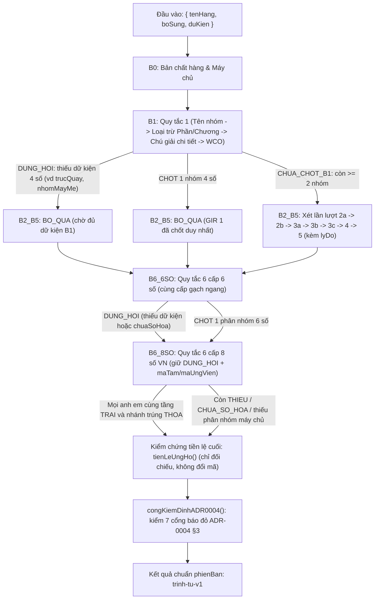

# Đề xuất khuôn "bộ máy trình tự" (`lib/do-thi/bo-may-trinh-tu.js`) thay thế `lib/gir.js`

- **Việc:** `#1636` Việc 4 (tuân thủ [ADR-0004](../decisions/0004-quy-trinh-phan-loai-chuan-6-quy-tac.md))
- **Trạng thái:** Đề xuất khuôn mẫu & cài đặt tất định (`0` AI, cô lập hoàn toàn khỏi đường khách, chờ QT duyệt khuôn trước khi đấu nối)
- **Tệp mã:** [`lib/do-thi/bo-may-trinh-tu.js`](../../lib/do-thi/bo-may-trinh-tu.js)
- **Bộ kiểm:** [`scripts/test-bo-may-trinh-tu.mjs`](../../scripts/test-bo-may-trinh-tu.mjs)
- **Khai báo bảng đấu nối:** [`data/luat/dau-noi.json`](../../data/luat/dau-noi.json) (`kho.bangCanh.moDun`)

---

## 1. Vì sao `lib/gir.js` (gán nhãn hậu kiểm) không đạt ADR-0004

[`lib/gir.js`](../../lib/gir.js) được thiết kế để **gán nhãn GIR sau khi động cơ đã chọn mã** (`determineGir({ description, candidates, pickedHs, resolver, headingNote, isSet, precedentDrove, llmGir })`), nên vi phạm trực tiếp cấu trúc pháp lý của ADR-0004:

| Khía cạnh | `lib/gir.js` (hiện tại) | Bộ máy trình tự (`bo-may-trinh-tu.js`, ADR-0004) |
|---|---|---|
| Vai trò điều khiển | **Hậu kiểm (post-hoc)**: nhận `pickedHs` đã chọn rồi mới suy nhãn GIR giải thích ngược lại | **Dẫn đường bắt buộc (state machine)**: đi từng tầng `B0 -> B1 -> B2_B5 -> B6_6SO -> B6_8SO`, không cho phép nhảy cóc |
| Xác định bản chất & máy chủ (B0) | Không có tầng B0; không bắt buộc phân loại máy chủ trước cho bộ phận hay dòng `"Của hàng hóa thuộc phân nhóm X"` | Bắt buộc xét bản chất hàng, chất liệu, trạng thái, và phân loại **máy chủ** ở `B0` trước khi vào `B1` |
| Thứ tự đọc luật & loại trừ (B1) | Chỉ kiểm tra chuỗi `"không bao gồm"` ở `headingNote` (mức `HEURISTIC`), không đọc chú giải Phần/Chương, không ép thứ tự `2(a) -> 2(b) -> 2(c)` | Đọc đúng thứ tự: **tên nhóm -> chú giải Phần/Chương (loại trừ trước) -> chú giải chi tiết -> WCO**; Phần XVI đi qua `xetChuGiai2PhanXVI()` |
| Tách Quy tắc 1 vs Quy tắc 2–5 | Cho phép `2(a)`, `2(b)`, `3(b)`, `3(c)`, `5` bật song song qua regex từ khoá dù GIR 1 đã đủ | `B2_B5` chuyển sang `BO_QUA` khi `B1` đã chốt 1 nhóm hoặc dừng hỏi; chỉ kích hoạt khi `B1` không giải quyết được và phải ghi rõ `lyDo` |
| Thiếu dữ kiện & `"Loại khác"` | Không có cơ chế dừng hỏi có căn cứ khi thiếu điều kiện luật | Thiếu dữ kiện phân nhánh trả **`DUNG_HOI`** kèm `cauHoi` + `maUngVien` / `maTam`; cấm rơi vào `"Loại khác"` nếu còn anh em cùng tầng chưa `TRAI` |
| Trích dẫn nguyên văn (`trich[]`) | `evidence` là cụm khớp hoặc `subheadingsCompared` (không bắt buộc trích nguyên văn trỏ tệp + khoá) | Mọi tầng hoạt động bắt buộc có `trich[]` nguyên văn `{ tep, khoa, nguyenVan }` trỏ tới khoá thật trên đĩa |
| Vai trò tiền lệ | Cho phép `precedentDrove` phát nhãn `GIR 4`; trộn `LLM_ASSERTED` | `tienLeUngHo` chỉ chạy ở **bước cuối** để kiểm chứng (`KIEM_CHUNG_CUOI`), tuyệt đối không chọn hay đổi mã |

---

## 2. Sơ đồ chuyển tiếp 5 tầng & kiểm chứng tiền lệ cuối

Luồng xử lý tất định đi đúng 5 tầng `TRINH_TU_TANG = ["B0", "B1", "B2_B5", "B6_6SO", "B6_8SO"]`, tiếp nối bởi bước kiểm chứng tiền lệ cuối và cổng tự kiểm ADR-0004 §3:



---

## 3. Lược đồ chuẩn từng tầng và đối tượng trả về đầy đủ (`phienBan: "trinh-tu-v1"`)

### 3.1 Lược đồ chuẩn từng tầng (`cacTang[i]`)

Mỗi phần tử trong `cacTang` mang đầy đủ:

```json
{
  "tang": "B0 | B1 | B2_B5 | B6_6SO | B6_8SO",
  "trangThai": "CHOT | DUNG_HOI | BO_QUA",
  "quyTac": "Tên quy tắc pháp lý quyết định ở tầng này",
  "ketLuan": "Mã nhóm / phân nhóm / dòng / mô tả bản chất / DUNG_HOI / BO_QUA",
  "lyDo": "Giải thích ngắn gọn cơ chế quyết định (bắt buộc với B2_B5)",
  "cauHoi": "Chuỗi câu hỏi tiếng Việt (bắt buộc khi trangThai === 'DUNG_HOI')",
  "chiTietCauHoi": {
    "khoa": "Tên trường dữ kiện cần hỏi",
    "noiDung": "Nội dung câu hỏi",
    "luaChon": ["Phương án A", "Phương án B"],
    "dieuKienLuat": "Điều kiện luật dẫn tới câu hỏi",
    "canCu": "Nguồn pháp lý"
  },
  "trich": [
    {
      "tep": "data/chu-giai-chuong.json | data/chu-giai-heading.json | data/wco-op/opinions.json | data/wco-hs-international.csv | data/tax.json",
      "khoa": "Khoá thực trên đĩa (<2d>.chuong|phan, <4d>.ten_nhom|nhom, <id>.text, <6d>, <8d>.vn)",
      "nguyenVan": "Đoạn trích nguyên văn khớp 100% giá trị tại tep + khoa",
      "headingSuspect": true,
      "headingContinued": true
    }
  ]
}
```

### 3.2 Đối tượng trả về đầy đủ của `phanLoaiTheoTrinhTu(dauVao, opts)`

```json
{
  "phienBan": "trinh-tu-v1",
  "dauVao": { "tenHang": "...", "boSung": {} },
  "ketQua": {
    "trangThai": "CHOT | DUNG_HOI",
    "ma": "84313120 | null",
    "nhom": "8431",
    "phanNhom": "843131",
    "dieuKienKemTheo": "Ghi chú ranh giới thay đổi cấu hình (nếu có)",
    "maTam": "64029990 (chỉ khi ADR-0004 §5 có mã tạm khi DUNG_HOI)",
    "phanNhomTam": "640299",
    "nhomUngVien": ["8483", "8431"],
    "maUngVien": ["84313110", "84313120"],
    "cauHoi": "Câu hỏi phân nhánh khi DUNG_HOI",
    "chiTietCauHoi": {}
  },
  "cacTang": [ "..." ],
  "kiemChungTienLe": {
    "trangThai": "DA_KIEM | CHUA_KIEM",
    "vaiTro": "KIEM_CHUNG_CUOI",
    "anhHuongChotMa": false,
    "maDuocKiem": "...",
    "soTienLe": 0,
    "cungMa": 0,
    "cungNhom": 0,
    "nhomKhac": [],
    "biPhanDoi": [],
    "canhBaoLechLuat": "Cảnh báo nếu tiền lệ trái chuỗi luật (nếu có)"
  },
  "canhBaoDuLieu": [],
  "vetXet": [],
  "congKiemDinhADR0004": {
    "dat": true,
    "viPham": [],
    "daKiem": []
  }
}
```

---

## 4. Quy tắc minh bạch dữ liệu & các chốt kiểm định ADR-0004

1. **Minh bạch cờ nghi ngờ OCR WCO (`headingSuspect`)**:
   - Ý kiến WCO có cờ `headingSuspect: true` (ví dụ `392490/4` trong [`data/wco-op/opinions.json`](../../data/wco-op/opinions.json) có `ordPrinted: 6` lệch `ord: 4`, `headingContinued: true`) được giữ nguyên cờ `headingSuspect: true` ngay trên `trich[]` và ghi nhận vào `canhBaoDuLieu`, đồng thời **không** làm suy yếu cổng API công khai `lib/wco-op.js#view`.
2. **Minh bạch phân nhóm chưa số hoá (`chuaSoHoa`) & nhóm chưa soạn `tieuChi6`**:
   - Phân nhóm `6402.20` (`chuaSoHoa` trong `data/so-tay/6402.json`) không bị bỏ qua để rơi xuống `6402.99`: khi thiếu dữ kiện `coChotCai`, bộ máy bắt buộc dừng ở `DUNG_HOI` và ghi cảnh báo `CHUA_SO_HOA` vào `canhBaoDuLieu`.
   - Các nhóm chưa có `tieuChi6` (`3212`, `7603`) hoặc chỉ có 1 phân nhóm (`8503` -> `850300`) dùng cấu trúc cây [`lib/hs-tree.js`](../../lib/hs-tree.js) kết hợp văn bản WCO 6 số ([`data/wco-hs-international.csv`](../../data/wco-hs-international.csv)) và biểu thuế VN ([`data/tax.json`](../../data/tax.json)) theo đúng cấp gạch ngang.
3. **Tránh lỗi văn bản Phần trong `chu-giai-chuong.json`**:
   - Khối `39.phan` và `40.phan` đang bị dính văn bản Phần VI; bộ máy cấm đọc `39.phan`/`40.phan` và đọc thẳng `39.chuong` (ví dụ kiểm Chú giải 2(s) Chương 39 khi `coVan: true` để loại sang `84.81`).
4. **Nhánh máy chủ trước cho mẫu `"Của hàng hóa thuộc phân nhóm X"`**:
   - Với `8431.31.10/20` (máy chủ `8428.10.31` chở người vs `8428.10.39/40`), `8431.43.00` (máy khoan `8430.41`/`8430.49`), và `8503.00.20` (máy phát điện `85.01`/`85.02` công suất `>= 12.500 kVA`), máy chủ phải được xác định ở `B0` trước; thiếu thuộc tính quyết định của máy chủ thì dừng ở `DUNG_HOI`.
5. **Cấm tự rơi vào `"Loại khác"`**:
   - Cả ở mức 6 số (`phanConLai: true`) lẫn mức 8 số (`loaiKhac: true`), chỉ được kết luận `"Loại khác"` khi **mọi** anh em cùng cấp gạch ngang đứng trước/cùng tầng đều đã chứng minh `TRAI` (`MAU_THUAN`). Nếu bất kỳ anh em nào đang `THIEU`, `CHUA_BIET` hoặc `CHUA_SO_HOA` -> trả `DUNG_HOI`; khi chốt `"Loại khác"` ở mức 8 số, `B6_8SO.trich` bắt buộc phải có mặt đủ trích dẫn `<8d>.vn` của toàn bộ anh em cùng tầng để chứng minh đã xét và loại trừ hết.
6. **Nối thật đồ thị tri thức `lib/do-thi/index.js#bangCanh()` (`LOAI_TRU`, `WCO`, `C5`, `C9`, `C10`, `C11`)**:
   - Ngoài các họ đặc thù (`BOT_KIM_LOAI`, `VE_SINH`, `GIAY_DEP_CH64`, `PHAN_XVI`), đường tổng quát tra trực tiếp chỉ mục cụm `c1Map` + tiêu đề nhóm `chu-giai-heading.json` (lọc theo chất liệu để tránh gán nhựa `3924` cho inox/đồng/sứ hoặc `6402` cho giày dép da), rồi gọi `canhTu()`, `canhToi()`, `canhNgangCuaNhom()` soát cạnh `LOAI_TRU`, `C5`, `C9`, `C10`, `C11` và `WCO`.
7. **Đủ 7 cổng báo đỏ của `congKiemDinhADR0004` (`kiemDinhADR0004`, ADR-0004 §3)**:
   1) **Có tầng không kèm trích dẫn (`KHONG_NHAY_COC_TANG`, `TRICH_VA_QUY_TAC_*`, `TRICH_KHONG_HOP_LE`)**: Bắt buộc đi đúng thứ tự `B0 -> B1 -> B2_B5 -> B6_6SO -> B6_8SO` và mọi tầng hoạt động phải có `quyTac` + `trich[]` nguyên văn khớp 100% tệp thật trên đĩa.
   2) **Viện dẫn Quy tắc 3 khi đã có nhóm khớp Quy tắc 1 (`KHONG_VIEN_DAN_QT3_KHI_B1_DA_QUYET`, `B2_B5_CO_LY_DO`)**: `B2_B5` phải là `BO_QUA` (và không viện dẫn Quy tắc 3 / GIR 3) khi `B1` đã chốt hoặc `DUNG_HOI`; mọi trạng thái của `B2_B5` đều phải có `lyDo`.
   3) **Dùng tiền lệ làm căn cứ chọn mã (`TIEN_LE_CHI_KIEM_CHUNG_CUOI`)**: `tienLeUngHo` chỉ được phép chạy sau `B6_8SO` với `vaiTro: "KIEM_CHUNG_CUOI"`, `anhHuongChotMa: false`, và không tầng nào được lấy `GIR 4` / tiền lệ để chọn mã.
   4) **Mã thuộc Phần XV / Chương 73 mà chưa soát Chú giải 1(f) Phần XV và Chú giải 2 Phần XVI (`SOAT_LOAI_TRU_PHAN_XV_XVI`)**: Mọi mã kết luận hoặc ứng viên rơi vào Phần XV / Chương `72..83` (lò xo, bu lông, vít, ống thép, bột nhôm `76.03`, bột đồng `74.06`, đồ vệ sinh thép/đồng `73.24`/`74.18`...) bắt buộc ghi nhận `daSoat` **VÀ** có trích dẫn thật trong `B1.trich` từ `data/chu-giai-chuong.json` cho cả **Chú giải 1(f) Phần XV** (`72..83.phan`) lẫn **Chú giải 2 Phần XVI** (`84/85.phan`, không cho qua bằng chuỗi `quyTac`).
   5) **Điều kiện đảo ngược vế `"trừ / nhưng không"` (`KHONG_DAO_NGUOC_VE_TRU` / cổng `KHOA_NGUOC_VE_TRU`)**: Quét điều kiện `tieuChi6` qua `laKhoaNguocVeTru()` để chặn lỗi đảo ngược vế loại trừ.
   6) **Điều kiện rộng hơn hoặc hẹp hơn chữ luật (`DIEU_KIEN_KHONG_LECH_CHU_LUAT`, `SO_SANH_CUNG_CAP_GACH`)**: Kiểm thật trên `lib/hs-tree.js` (`T.nodeOf`) bảo đảm các phân nhóm trong `B6_6SO.trich` có cùng `depth` (cùng cấp gạch ngang) và cùng `parent` khi chốt 6 số; kiểm khớp chất liệu nhóm luật định (`3924` đòi plastic, `6401/6402` cấm da thuộc, `73xx/74xx/76xx` khớp kim loại); kiểm đủ cấp máy chủ cho mọi mẫu `"Của/Thuộc phân nhóm X"` (`8431.20.10`, `8431.31.10/20`, `8431.43.00`, `8503.00.20`).
   7) **Chốt mã khi điều kiện luật đang thiếu dữ kiện thay vì dừng hỏi (`CHOT_MA_DU_DU_KIEN`, `DUNG_HOI_HOP_LE`, `DUNG_HOI_CO_CAU_HOI_*`)**: Thiếu dữ kiện phân nhánh bắt buộc `DUNG_HOI` kèm `cauHoi` + danh sách ứng viên (`>= 2`); cấm chốt mã khi còn tầng `DUNG_HOI`, còn dữ kiện thiếu, hoặc rơi vào `"Loại khác"` khi `B6_8SO.trich` thiếu trích dẫn đầy đủ các dòng anh em cùng tầng.

---

## 5. Cách đo theo ADR-0004 §4 & kế hoạch nối đường khách

### 5.1 Thước đo chuẩn ADR-0004 §4 (không dùng `"đúng mã 8 số %"` của bộ tờ khai cũ)

- **Chân lý là chữ luật, không phải mã tờ khai:** Bộ chuẩn (`bo-chuan-v1.json`) gắn nhãn theo chuỗi quy tắc và trích dẫn nguyên văn; ca thiếu dữ kiện mang nhãn đúng là `"dừng hỏi + câu hỏi"`.
- **Đo theo bậc thang 3 tầng**, mỗi tầng xếp kết quả vào 3 ô **`đúng / sai / dừng hỏi đúng chỗ`**:
  - **`T1` (4 số):** có thể dùng AI ở pha tích hợp đường khách (hiện tại bản cô lập tất định không gọi AI).
  - **`T2` (4 -> 6), đưa sẵn nhóm đúng:** tất định, không cần AI.
  - **`T3` (6 -> 8), đưa sẵn phân nhóm đúng:** tất định, không cần AI.
- **Đích đạt chuẩn:**
  - `T2` và `T3`: **`sai = 0`**.
  - `T1`: tiến tới mức chuyên gia.
  - Mọi tầng: hỏi đúng chỗ thiếu, không đoán.

### 5.2 Kế hoạch nối vào đường khách giai đoạn sau & điều kiện QT duyệt khuôn

- **Hiện trạng cô lập (Việc 4):** [`lib/do-thi/bo-may-trinh-tu.js`](../../lib/do-thi/bo-may-trinh-tu.js) chỉ được khai báo trong [`data/luat/dau-noi.json`](../../data/luat/dau-noi.json) mục `kho.bangCanh.moDun`, **chưa** có tệp nào trong `api/`, `lib/*.js` (ngoài `lib/do-thi/`) hay `server.js` nạp nó, không dùng biến môi trường `HS_*` mới, `0` gọi AI và `0` gọi mạng.
- **Điều kiện QT duyệt khuôn trước khi mở giai đoạn nối đường khách:**
  1. QT rà soát và chốt khuôn đối tượng `trinh-tu-v1` (`ketQua`, `cacTang`, `cauHoi`, `kiemChungTienLe`, `congKiemDinhADR0004`) cùng khả năng tương thích ngược với ERP / Cổng OZ (`nextAction.questions`).
  2. Bộ đo kiểm chứng trên `bo-chuan-v1.json` + các ca phản chứng `boSung` + kiểm tra 7 cổng báo đỏ ADR-0004 §3 và thang `T1 / T2 / T3` (`đúng / sai / dừng hỏi đúng chỗ`) đạt `0` vi phạm, `0` lỗi trích dẫn nguyên văn và `sai = 0` ở `T2` / `T3`.
  3. Khi mở PR nối đường khách: mọi thay đổi trên đường khách phải đặt sau công tắc `HS_*` mặc định TẮT (Luật L1), cập nhật `duong[].doc.bangCanh` trong `dau-noi.json` (Luật L4), và chỉ bật/thay thế [`lib/gir.js`](../../lib/gir.js) sau khi có số đo trên chuỗi mô hình máy thật qua Cổng thật (Luật L1, L5, L10, L11).
