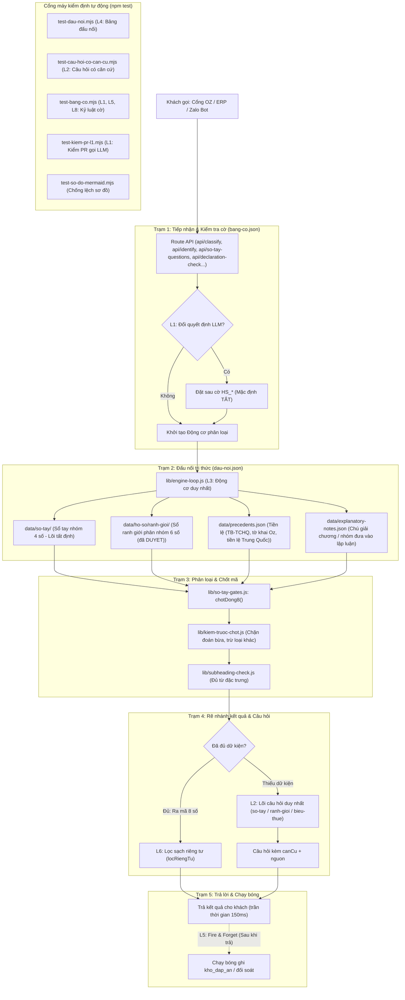

# Luật đường khách

Áp dụng cho mọi người và mọi agent sửa mã trong repo này. Quyết định gốc: [`docs/decisions/0001-luat-duong-khach-va-bang-dau-noi.md`](decisions/0001-luat-duong-khach-va-bang-dau-noi.md).

**Đường khách** = mọi đường mà kết quả tới tay khách thật: các route trong `api/` mà Cổng OZ, ERP, bot Zalo gọi
(`/api/classify`, `/api/identify`, `/api/so-tay-questions`, `/api/describe`, `/api/suggest`…). Danh sách đầy đủ và trạng
thái từng đường nằm ở [`data/luat/dau-noi.json`](../data/luat/dau-noi.json).

**Máy thật** = container `hs-code-api` trên .120, gọi qua Cổng OZ. **Dev** = mọi máy khác (.131, máy agent, CI).

Mỗi luật có ba phần: việc phải làm, vì sao (sự việc thật), kiểm bằng gì. Luật nào ghi "cổng máy" thì `npm test` hoặc CI
tự đỏ khi phạm; luật nào ghi "người soát" thì người soát PR phải kiểm bằng tay theo mẫu PR.

| Luật | Một dòng | Kiểm bằng |
|---|---|---|
| L1 | Đổi hành vi LLM trên đường khách: sau công tắc mặc định TẮT, đo bằng chuỗi mô hình máy thật | cổng máy (một phần) + người soát |
| L2 | Một lõi câu hỏi duy nhất, câu nào cũng có `canCu` + `nguon` | cổng máy |
| L3 | Chỉ động cơ phân loại được quyết nhóm / phân nhóm | người soát |
| L4 | Bảng đấu nối là nguồn sự thật: đường nào đọc tri thức nào | cổng máy |
| L5 | Chạy bóng không chặn đường trả lời; cờ bóng có chủ + ngày xét | cổng máy (phần chủ + ngày) + người soát |
| L6 | "Chưa kiểm" khác "đã kiểm, không có" | người soát |
| L7 | Chỉ số có mẫu số đúng nghĩa; báo số kèm phép đo + mô hình | người soát |
| L8 | Tài liệu nêu giá trị cờ phải khớp mã | cổng máy |
| L9 | Đo có tra web ở dev: tối đa một vòng | người soát |
| L10 | PR xếp chồng: ghi thứ tự gộp | người soát |
| L11 | Nhánh tối ưu không được bỏ bước đọc tri thức khi có tín hiệu trái; bỏ bước nào phải ghi bước đó CHƯA chạy | cổng máy (phần khai nhánh) + người soát |

---

## Sơ đồ luồng đường khách & 4 cổng máy (ADR-0001)

Sơ đồ trực quan luồng đi của một yêu cầu từ khách qua các trạm gác và cổng kiểm định tự động:

<!-- AUTO_MERMAID_DUONG_KHACH_START -->

<!-- AUTO_MERMAID_DUONG_KHACH_END -->

---

## L1 — Đổi hành vi LLM trên đường khách

Thay đổi thuộc L1 khi nó làm LLM quyết định khác đi trên đường khách: đổi prompt, thêm hoặc bớt lượt gọi LLM, đổi chuỗi
mô hình (`lib/llm-tier.js`, `lib/llm.mjs`), để LLM chọn nhóm / chương / câu hỏi.

Làm đủ năm việc, theo thứ tự:

1. Đặt thay đổi sau **một công tắc `HS_*` mặc định TẮT**. Khai công tắc vào `data/luat/bang-co.json` với
   `doiQuyetDinhLLM: true`.
2. Chứng minh **tắt = như `main`**: chạy cùng bộ ca với LLM giả trên `origin/main` và trên nhánh, so băm (sha256) đầu
   ra sau khi bỏ trường thời gian. Dán hai mã băm vào PR.
3. Số đo để **nhận** thay đổi phải lấy **bằng chuỗi mô hình của máy thật, qua Cổng thật**. Số đo bằng mô hình khác
   (Gemini flash ở dev, LLM giả) chỉ để tự kiểm, **không được dùng làm lý do gộp hay bật**.
4. Gộp khi công tắc còn TẮT. QT bật trên máy thật, **đo ngay** cùng bộ mẫu.
5. Số đo trên máy thật xấu hơn trước khi bật: **tắt công tắc trước, sửa sau**. Nếu công tắc không tắt sạch được thì
   hoàn nguyên PR trước, sửa sau.

Công tắc phải là nút quay lui thật: tắt là hết tác dụng, không cần deploy mã khác.

**Vì sao:** PR #1517 đổi prompt và thêm lượt LLM cho `/api/identify`, đo ở dev bằng Gemini flash đúng 10/10. Lên máy
thật (chuỗi mô hình khác) sai nhóm 5/10, phải hoàn nguyên (#1519). Công tắc của nó mặc định BẬT và không quay lui được.

**Kiểm bằng:**
- Cổng máy `scripts/test-bang-co.mjs`: cờ khai `doiQuyetDinhLLM: true` mà mặc định BẬT thì đỏ (trừ danh sách cờ cũ đã
  ghi tên, chỉ được ngắn đi).
- Cổng CI `.github/workflows/luat-l1.yml` (`scripts/kiem-pr-l1.mjs`): PR đụng tệp gọi LLM mà thân PR không trả lời mục
  L1 thì đỏ. Trả lời bằng một trong hai dòng của mẫu PR.
- Người soát: đọc số đo, hỏi "đo bằng mô hình nào, qua đâu". Không có câu trả lời thì TRẢ THỢ.

## L2 — Một lõi câu hỏi duy nhất

Mọi câu hỏi gửi khách phải lấy từ một trong các nguồn có căn cứ sau, và mang hai trường `canCu` + `nguon`:

| `canCu` | Nguồn | Module |
|---|---|---|
| `so-tay` | Sổ tay nhóm 4 số `data/so-tay/` | `lib/so-tay-cau-hoi.js` (lõi tất định), `lib/hoi-theo-so-tay.js` (dựng lại câu hỏi của `/api/classify`, sau cờ `HS_HOI_THEO_SO_TAY`) |
| `ranh-gioi-pn6` | Sổ ranh giới PN6 `data/ho-so/ranh-gioi/` | như trên, đọc qua `lib/so-tay-gates.js` |
| `truong-khai-nhom` | Trường khai bắt buộc theo nhóm | `lib/declaration-fields.js` |
| `bieu-thue` | Chữ nguyên văn các dòng 8 số của biểu thuế (chọn dòng khi sổ chưa có điều kiện) | `lib/hoi-theo-so-tay.js` |
| bảng quyết định | `data/conflict-tables.json` (người soạn, dẫn văn bản gốc) | `lib/decision-tables.js`, `lib/conflict-resolver.js` |

Cấm:
- Thêm bảng câu hỏi cứng theo chương hay theo mặt hàng ở module khác.
- Để LLM tự nghĩ câu hỏi rồi gửi khách. Câu của LLM chỉ được đi vào ghi chú (`ghiChuThem`), không vào danh sách hỏi.
- Viết lõi thứ hai. Cần câu hỏi mới thì bổ sung sổ tay / sổ PN6 / danh mục trường khai rồi để lõi sinh câu.

**Vì sao:** van điện từ khí nén 5/2 qua Cổng ngày 21/11 bị hỏi 6 câu do LLM tự nghĩ (điện áp cuộn dây, model, hãng…),
không câu nào là điều kiện phân biệt của nhóm 84.81. Câu hỏi theo sổ khi đó chỉ có ở `/api/so-tay-questions`; PR #1523 đưa
lõi đó vào `/api/classify` sau cờ `HS_HOI_THEO_SO_TAY`.

**Kiểm bằng:** cổng máy `scripts/test-cau-hoi-co-can-cu.mjs`. Mọi tệp trong `lib/`, `api/` có dựng câu hỏi
(`questionVi:`) phải được khai ở `data/luat/dau-noi.json` mục `noiDungCauHoi`: là lõi, là nơi chuyển tiếp, hoặc là
ngoại lệ có số thẻ. Tệp mới dựng câu hỏi mà chưa khai thì đỏ. Danh sách ngoại lệ có trần cứng trong test, chỉ được hạ.

## L3 — Chỉ động cơ phân loại quyết nhóm

Nhóm 4 số và phân nhóm 6 số chỉ do động cơ phân loại (`lib/engine-loop.js`, và `lib/classify.js` khi tắt `loop`) quyết.
Module khác cần nhóm thì **nhận từ bên gọi** hoặc từ kết quả động cơ. Cấm tự đoán nhóm bằng một lượt LLM riêng hay
bằng tìm kiếm từ khoá.

Luật qua test "nhờ may" là không đạt. Ca test phải **chứng minh cơ chế**: nêu vì sao ra kết quả đó, và có **ca ngược**
(đầu vào đổi một dữ kiện thì kết quả phải đổi theo, hoặc đầu vào bẫy thì không được khớp).

**Vì sao:** một bản cho LLM tự đoán nhóm 4 số rồi kéo sổ tay nhóm đó ra hỏi; đoán sai là cả bộ câu hỏi sai (PLC bị hỏi
về van). Một bản khác đoán nhóm bằng tìm từ khoá, test xanh vì tình cờ trúng.

**Kiểm bằng:** người soát. Hỏi "nhóm ở dòng này lấy từ đâu" và "ca ngược đâu". Bảng đấu nối (L4) ghi rõ
`/api/identify` không tự suy nhóm.

### L3 bổ sung — Câu hỏi theo sổ chỉ đúng khi nhóm đúng

Lõi câu hỏi (L2) hỏi theo sổ của **nhóm mà động cơ đưa ra**. Nhóm sai thì câu hỏi có căn cứ đầy đủ mà vẫn sai hàng.

- Trước khi bật một tính năng hỏi theo sổ trên máy thật: đo **tỉ lệ đúng nhóm 4 số của chính nhánh sinh ra câu hỏi**
  (nhánh dừng sớm, nhánh hỏi) trên bộ mẫu thật, qua Cổng thật. Chưa có số này thì chưa bật.
- Câu hỏi sai hàng trên máy thật: **tắt công tắc trước** (L1), rồi sửa ở chỗ quyết nhóm. Cấm vá ở lõi câu hỏi (lọc
  câu, thêm ngoại lệ theo mặt hàng) để che nhóm sai.
- `HS_HOI_THEO_SO_TAY` chỉ bật lại sau khi nhánh dừng sớm đã sửa (OZV-1707) và ca van khí nén 5/2 ra đúng nhóm 84.81.

**Vì sao:** trưa 21/11 QT bật `HS_HOI_THEO_SO_TAY` trên máy thật. Ca van điện từ khí nén 5/2: động cơ dừng sớm ở
`8412.21`, nên khách bị hỏi "van trượt cho động cơ hơi nước" theo đúng sổ của nhóm 84.12. QT phải tắt.

**Kiểm bằng:** người soát + QT khi bật. Bảng cờ ghi điều kiện bật lại ở `HS_HOI_THEO_SO_TAY`; nhánh dừng sớm khai ở
`data/luat/dau-noi.json` mục `nhanhBoQua`.

## L4 — Bảng đấu nối là nguồn sự thật

`data/luat/dau-noi.json` khai cho từng đường vào: đọc kho tri thức nào (sổ tay nhóm, sổ PN6, tiền lệ, chú giải), qua
module nào, sau cờ nào, có dùng lõi câu hỏi chung không, và nhánh nào trong động cơ đang bỏ qua tri thức.

- Thêm route mới trong `api/` hoặc `routes.json`: khai vào bảng trong cùng PR.
- Nối hoặc gỡ một kho tri thức khỏi một đường: sửa bảng trong cùng PR.
- Nâng cấp kho tri thức phải tới **mọi đường** qua lõi chung. Cấm mỗi đường tự nối riêng sau cờ riêng. Đường nào chưa
  nối thì bảng ghi `"khong"` kèm số thẻ theo dõi; không được im lặng.
- Trả lời câu "đường X có dùng sổ tay không" bằng cách đọc bảng, không đọc lại mã.

**Vì sao:** sổ tay nhóm (1.243) và sổ ranh giới PN6 (2.140) nâng cấp ở kho nhưng `/api/identify` không đọc;
`/api/classify` nhánh `earlyExitHoiTuR1` bỏ vòng 2 nên bỏ luôn sổ tay dù `HS_SO_TAY=full`. Van khí nén 5/2 ra `848180`
thay vì `848120` dù có 2 TB-TCHQ trùng khít. Không ai biết cho tới khi khách gặp.

**Kiểm bằng:** cổng máy `scripts/test-dau-noi.mjs`. Đối chiếu bảng với mã bằng đồ thị `require` thật. Đỏ khi: route
chưa khai; khai "có" mà mã không nạp module đọc kho; khai "không" mà mã đã nạp; cờ ghi trong bảng không có trong mã;
nhánh ngoại lệ đã biến mất khỏi mã mà bảng còn ghi.

Giới hạn: cổng chứng minh mã **nạp được** kho, không chứng minh mọi nhánh lúc chạy đều **dùng**. Nhánh bỏ qua đã biết
phải khai ở mục `nhanhBoQua`.

## L5 — Chạy bóng và số đo

1. Chạy bóng **không bao giờ chặn đường trả lời**. Trả khách xong mới làm việc bóng (hàng chạy nền). Cấm `await` một
   việc bóng trước khi trả.
2. Mỗi dòng số đo có đủ: **bên gọi**, **lý do bỏ qua** (nếu lượt bị bỏ qua thì vẫn ghi một dòng), **chi phí LLM**.
3. Mỗi cờ có chế độ `shadow` phải có trong `data/luat/bang-co.json` một khối `bong`: **chủ**, **ngày xét**, **tiêu chí
   bật**, **tiêu chí tắt**, **thẻ theo dõi**, **lấy số ở đâu**.
4. Tới ngày xét, chủ phải quyết: bật, tắt, hoặc gia hạn kèm lý do và ngày mới. **Quá ngày xét mà chưa quyết là lỗi.**

**Vì sao:** `HS_HO_SO=shadow` từng CHỜ dựng hồ sơ (gọi LLM trả tiền, ~13 giây) rồi mới trả khách; số đo không ghi bên
gọi, lượt bỏ qua không để dấu, chi phí LLM không ghi. Tài liệu ghi "chạy bóng 5 ngày rồi trình bật" nhưng không ai là
chủ lấy số, nên nằm im.

**Kiểm bằng:** cổng máy `scripts/test-bang-co.mjs` (cờ có `shadow` thiếu khối `bong`, thiếu chủ / ngày / tiêu chí, hoặc
quá ngày xét khi đang chạy thì đỏ). Việc "không chặn" có test riêng cho hồ sơ
(`scripts/test-ho-so-shadow-chay-nen.mjs`); chế độ bóng mới phải có test tương tự, người soát kiểm.

## L6 — "Chưa kiểm" khác "đã kiểm, không có"

Trường trạng thái phải có một giá trị riêng cho "chưa kiểm" (`CHUA_KIEM`, `null`, hoặc vắng trường). Cấm khởi tạo bằng
một giá trị trùng với một kết quả thật.

**Vì sao:** `soTay.outcome: "NONE"` là giá trị khởi tạo, bị đọc thành "đã tra sổ, không có gì" trong khi nhánh đó chưa
hề tra sổ.

**Kiểm bằng:** người soát (mẫu PR có ô). Tồn đã biết: `soTay.outcome` ở `lib/engine-loop.js` (thẻ OZV-1707).

## L7 — Chỉ số có mẫu số đúng nghĩa

- Tách "không cần" khỏi "thiếu" trước khi tính tỉ lệ. Mẫu số chỉ gồm những lượt mà chỉ số có nghĩa.
- Tách bản nháp, lượt thử nội bộ, lượt bị bỏ qua khỏi lượt khách thật.
- Mỗi con số báo cáo ghi kèm: **phép đo** (lệnh hoặc script), **mô hình đã dùng**, **số mẫu**, **ngày**.

**Vì sao:** "rơi về LLM 3.652 phân nhóm" trong đó 2.924 là phân nhóm chỉ có 1 dòng, không cần hỏi. `rotVeMay 64%` gộp
cả bản nháp.

**Kiểm bằng:** người soát. Số không kèm phép đo + mô hình thì coi như chưa đo.

## L8 — Tài liệu khớp mã

Tài liệu nêu giá trị hay mặc định của cờ phải khớp mã và `Dockerfile`. Nguồn sự thật về cờ là
`data/luat/bang-co.json`; tài liệu khác trỏ tới đó thay vì chép lại. Đổi mặc định của cờ thì sửa bảng cờ trong cùng PR.

**Vì sao:** `docs/backlog/08` ghi máy thật chạy `gates` trong khi `Dockerfile` đặt `HS_SO_TAY=full` từ PR #361.

**Kiểm bằng:** cổng máy `scripts/test-bang-co.mjs`. Đỏ khi: mã có cờ `HS_*` chưa khai; bảng có cờ mà mã đã bỏ; đoạn mã
chứng minh mặc định không còn trong tệp; `ENV` trong `Dockerfile` lệch bảng; tài liệu vận hành nhắc cờ không tồn tại.

## L9 — Đo có tra web ở dev

Dev và máy thật ra mạng bằng **cùng một IP**. Bộ đo nào có gọi máy tìm kiếm (Brave, DuckDuckGo, Google, SearXNG) thì ở
dev chạy **tối đa một vòng**. Cần lặp thì dùng kết quả tra web đã lưu, hoặc tắt tra web
(`HS_DINH_DANH_TIM_WEB=off`, `HS_HO_SO_NGHIEN_CUU=false`).

**Vì sao:** đo lặp ở dev làm Brave / DDG / Google khoá IP chung; máy tìm kiếm của máy thật mất hết nguồn, không có
nguồn dự phòng.

**Kiểm bằng:** người soát. PR có số đo tra web phải ghi số vòng đã chạy.

## L10 — PR xếp chồng

PR dựa trên PR khác chưa gộp, hoặc hai PR đụng cùng tệp: dòng đầu thân PR ghi **`Gộp sau #N`** (hoặc `Gộp trước #N`).
Người gộp theo đúng thứ tự đó, cập nhật nhánh sau mỗi lần gộp.

**Vì sao:** PR xếp chồng gộp sai thứ tự gây xung đột, mất một vòng CI 27 phút.

**Kiểm bằng:** người soát (mẫu PR có dòng "Thứ tự gộp").

## L11 — Nhánh tối ưu không được bỏ bước đọc tri thức

Nhánh tối ưu = mọi nhánh rút ngắn đường đi vì tốc độ hay chi phí: dừng sớm, trả từ cache / kho đáp án, bỏ vòng 2, bỏ
lượt GIR, chốt sớm theo từ khoá.

1. Trước khi rẽ vào nhánh tối ưu, chạy các phép kiểm **tất định, rẻ** trên kết luận sắp trả: cổng sổ tay, tiền lệ trùng
   khít, mệnh đề loại trừ của chú giải. Có **tín hiệu tất định trái với kết luận** (vd có TB-TCHQ trùng khít ra mã
   khác, sổ tay loại trừ nhóm đang chọn) thì **không được rẽ**: đi đường đầy đủ.
2. Nhánh nào bỏ một bước đọc tri thức (sổ tay, sổ PN6, chú giải, tiền lệ) thì **kết quả trả về phải ghi rõ bước đó
   CHƯA chạy** (`CHUA_CHAY` kèm tên nhánh), không để trống, không để giá trị khởi tạo (L6).
3. Thêm nhánh tối ưu mới: khai vào `data/luat/dau-noi.json` mục `nhanhBoQua` (bỏ kho nào, vì sao, thẻ) trong cùng PR.
4. Số đo tốc độ / chi phí của nhánh tối ưu phải đi kèm số đo **đúng nhóm** của chính nhánh đó (L7). Nhanh hơn mà sai
   nhóm nhiều hơn là không đạt.

**Vì sao:** nhánh `earlyExitHoiTuR1` (thêm để rút ~21 giây) bỏ vòng 2 nên bỏ luôn sổ tay và tiền lệ. Van khí nén 5/2 có
2 TB-TCHQ trùng khít ra `848120`, nhánh này vẫn dừng ở `848180` (sáng 21/11) rồi `8412.21` (trưa 21/11). Kết quả ghi
`soTay.outcome: "NONE"` nên người đọc tưởng sổ đã được tra.

**Kiểm bằng:** cổng máy `scripts/test-dau-noi.mjs` giữ danh sách `nhanhBoQua` khớp mã (nhánh đã khai phải còn trong
mã, có thẻ, có kho bị bỏ). Việc "có tín hiệu trái thì không rẽ" và "ghi CHUA_CHAY" chưa dò tĩnh được: người soát kiểm,
và PR thêm nhánh tối ưu phải có ca test "có tiền lệ trùng khít trái kết luận ⇒ không dừng sớm". Tồn đã biết:
`earlyExitHoiTuR1` (OZV-1707).

---

## Thêm cờ `HS_*` mới: làm gì

1. Thêm một mục vào `data/luat/bang-co.json`: `ten`, `macDinh`, `loai`, `chu`, `mucDich`, `chungCu` (đoạn mã nguyên
   văn chứng minh mặc định).
2. Cờ đổi quyết định của LLM trên đường khách: `doiQuyetDinhLLM: true`, mặc định phải TẮT (L1).
3. Cờ có chế độ `shadow`: thêm khối `bong` (L5).
4. Chạy `node scripts/test-bang-co.mjs`.

## Thêm route hoặc nối tri thức: làm gì

1. Sửa `data/luat/dau-noi.json` (mục `duong`).
2. Có dựng câu hỏi gửi khách: gọi lõi chung (L2), không tự viết.
3. Chạy `node scripts/test-dau-noi.mjs && node scripts/test-cau-hoi-co-can-cu.mjs`.
