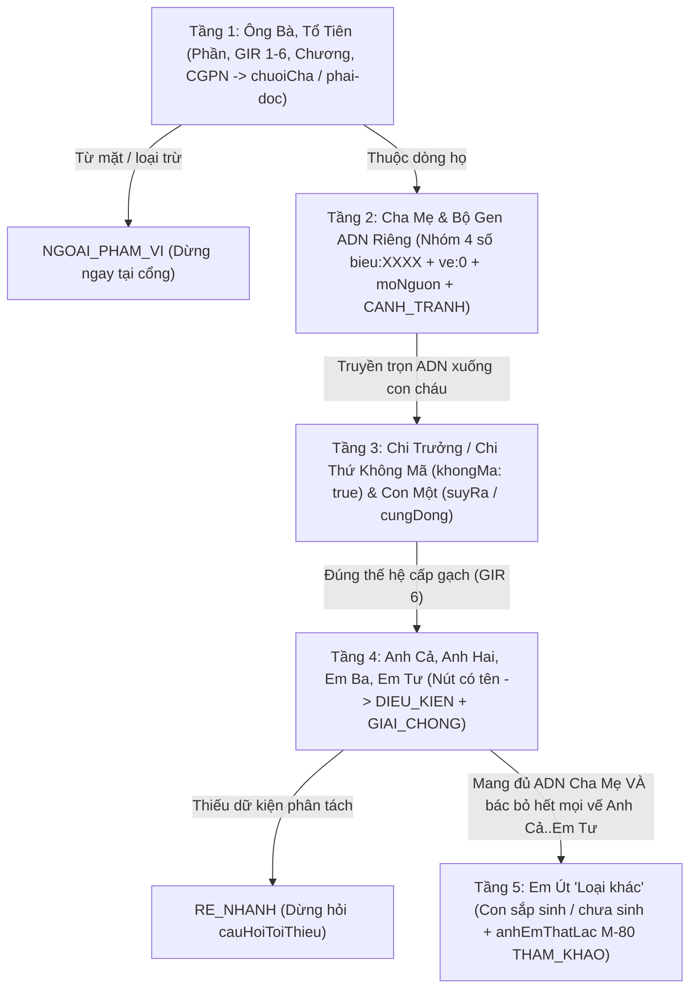

# Skill `doc-tron-nhom` — Đọc Trọn Nhóm 4 Số Theo ADR-0008 (M-81)

## 1. Mục đích, Phạm vi & Quy trình Một Lượt (ADR-0008)

Đọc và số hoá trọn vẹn **một gói nhóm 4 số** trong một lượt duy nhất (`goi-nhom.mjs` → `DIEU_KIEN`, `GIAI_CHONG`, `CANH_TRANH` → `bang-anh-em.mjs` → cổng `6–12` → `so-diem.mjs`), làm tới đâu ăn điểm tới đó và không đọc lại nhóm đã `DONG`.

- **Nơi lưu:** `data/ho-so-ma/dieu-kien/<chương>.jsonl` (`DIEU_KIEN`, `GIAI_CHONG`, `CANH_TRANH`) và `data/ho-so-ma/bang-anh-em/<chương>.jsonl` (máy sinh qua `scripts/ho-so-ma/bang-anh-em.mjs`, không viết tay).
- **Nhánh & Worktree:** Làm việc trên worktree cô lập `/Users/ozvietnamdesktop/Documents/Claude/Projects/hs-code-api-wt/<slug>` với nhánh `agy/...` tách sạch từ `origin/main`.
- **An toàn:** Không sửa đường khách L1 (`api/`, `lib/`, `data/prompts/`, `lib/llm-tier.js`, `lib/llm.mjs`, `lib/ho-so-ma/ghep.js`), không sửa bản ghi dữ liệu cũ trong `data/ho-so-ma/`, không đưa dữ liệu riêng tư (`data/oz-export/*`, `oz-gold*`, `.env`, `.keys/`) hay tiền lệ `tb:` vào điều kiện, tuyệt đối không chạy `gh pr merge` hay push thẳng lên `main`.

### Quy trình 9 bước một lượt cho một nhóm 4 số

1. **Lấy việc từ hàng đợi `so-diem.mjs --hang-doi`:** Chỉ nhận nhóm `CHUA`. Nhóm `DONG` không soạn lại. Nhóm `DO` chỉ sửa đúng bản ghi bị cổng chỉ ra hoặc đúng các nút trong `nutCanMoLai` khi vân tay câu luật đổi.
2. **Dựng gói đọc trọn nhóm (`goi-nhom.mjs --nhom <4so>`):** Gói gồm cây biểu thuế đầy đủ (`cayBieu`), gia đình anh em (`nhomAnhEm`), luật nền Phần/Chương/Phân chương/nhóm/phân nhóm/SEN (đã loại bỏ `WCO`, `PHAN_BIET`, `PHAN_BIET_NGHIA` và `tb:`), cạnh loại trừ vào/ra (`loaiTru`), hồ sơ M-72..M-75 sẵn có (`NGUONG`, `DINH_NGHIA`, `CHI_LIET_KE`), và `CANH_TRANH` từ `docs/mong/the/M-81-canh-tranh.md`. Nhóm quá dài tự tách `goiCon` theo phân nhóm 6 số nhưng vẫn giữ trọn chuỗi cha và anh em cùng cấp.
4. **Tách `DIEU_KIEN` cho mọi nút có tên (`id: hs:<nut>:81NN`):**
   - `ve` (số nguyên `>= 0`): `;` ngoài ngoặc hoặc `hoặc` phân nhánh độc lập ⇒ tăng `ve` (`1, 2, ...`); `và` ⇒ cùng `ve`; **`ve: 0`** ⇒ điều kiện chung áp lên mọi vế (thường là `phu: true` cho `"trừ…"` cuối danh sách, vẫn phải đủ số `ve >= 1` cho tên tách `;`).
   - `phu`: `true` cho `"trừ..."`, `"không kể..."`, `"không phải..."`.
   - `kieu`: `CO_KHONG` (cấm `nguong`, `tap`, `truc`, `daTri`); `SO` (bắt buộc trỏ `nguong` = `id` `NGUONG` M-74, không lặp số, cấm `tap`, `truc`, `daTri`); `GIA_TRI` (bắt buộc `truc` cục bộ trong gia đình anh em + `tap`, cấm `nguong`; tuỳ chọn `daTri: true` khi trục đa trị, mặc định `false` đơn trị).
   - `mo`: `DINH_NGHIA_LUAT` và `MO_TA_HUONG_DAN` bắt buộc kèm `moNguon` (`RE_CAU` trong kho luật gốc hoặc mảng id, kể cả chéo chương, cấm `tb:`); tuỳ chọn `moNguonVanTay` (sha256 hoặc `{ [id]: sha256 }`) do `tach-dieu-kien.mjs` tự gắn để `so-diem.mjs` phát hiện đổi chữ câu định nghĩa kể cả khi chưa có bản ghi `DINH_NGHIA`; `NGUONG` và `NGHIA_THUONG` cấm `moNguon`.
   - `nguon`, `trich`, `vanTay`: trích chuỗi con nguyên văn của câu `nguon` trong gói (`L.cau`), `vanTay = sha256(chu)`.
5. **Tách `GIAI_CHONG` hoặc soi chồng Cổng 8:** Với cặp anh em có thể cùng thoả trên cùng một món hàng (`VUNG_CHONG`), lập `GIAI_CHONG` (`TRU` | `QUY_TAC_3` | `CHU_GIAI` | `NGUONG`) kèm trích luật nguyên văn. Lưu ý: Cổng 8 chỉ chứng minh rời nhau cho `GIA_TRI` khi cùng `truc`, tập `tap` không giao **và cả hai đều đơn trị (`!daTri`)** (hoặc dùng `phu` bù / `SO`). Nếu một bên có `daTri: true`, Cổng 8 gắn `CHUA_CHUNG_MINH_TACH` cho tới khi có `GIAI_CHONG` trích luật.
7. **Rút ca thử từ ví dụ chú giải / SEN (Cổng 10 `DÒ`):** Kiểm đủ 3 loại kết quả (`VE_DONG` / `DICH`, `RE_NHANH` khi thiếu dữ kiện, `NGOAI_PHAM_VI` khi bị `ve: 0` hoặc `chuoiCha` loại ra).
8. **Kiểm kê `NGHIA_THUONG` (Cổng 11 `MỞ`):** Đếm đủ, không ép về `0`, mỗi bản ghi phải có `cauHoi` một dòng `<= 300` ký tự để dừng hỏi ở vùng biên.
9. **Chạy cổng & nộp bài sạch:** Chạy `bang-anh-em.mjs`, `cong.mjs --pham-vi <4so> --chi-trong --cong 6..12`, `so-diem.mjs --kiem-nhom <4so>`, `oz-pr-auditor`, rồi mới mở PR (tuyệt đối không chạy `gh pr merge` hay push thẳng lên `main`).

---

## 1b. Học Thuyết "Mỗi Nhóm 4 Số Là Một Gia Đình" (Ánh Xạ 5 Tầng Huyết Thống Sang M-81 & M-80)

Toàn bộ cơ chế M-81 (`ADR-0007`, `ADR-0008`) và `M-80` (`#2404`) vận hành theo học thuyết nghiệp vụ cốt lõi của CEO Anh Thắng: **mỗi nhóm 4 số không phải những dòng rời rạc, mà là một Gia Đình huyết thống 5 tầng khép kín**. Ong đọc trọn nhóm bắt buộc tư duy đúng từ trên xuống dưới theo sơ đồ gia phả sau:



### Tầng 1 — Ông Bà, Tổ Tiên (`Phần` & `Chương` → `chuoiCha` / `phai-doc`)
- Mỗi gia đình 4 số sinh ra trong một dòng họ lớn gồm **Chú giải Phần, 6 Quy tắc tổng quát (GIR 1–6), Chú giải Chương và Chú giải Phân nhóm**.
- Con cháu trong nhà bắt buộc tuân **gia pháp Ông Bà** trước tiên: nếu Ông Bà viết câu từ mặt (loại trừ sang nhóm hoặc chương khác, hoặc quy tắc ưu tiên nhóm khác như `61.11`, `61.13`, `85.24`, `85.41`, `85.42`) → kết luận **`NGOAI_PHAM_VI`** ngay từ cổng, tuyệt đối không xét xuống phân nhóm bên dưới.

### Tầng 2 — Cha Mẹ & Bộ Gen ADN Riêng (`Nhóm 4 số XXXX` → `DIEU_KIEN` của `bieu:XXXX` + `ve: 0` + `moNguon` + `CANH_TRANH`)
- Mỗi nhóm 4 số là **một gia đình độc lập mang Bộ Gen ADN riêng** (`DIEU_KIEN` tại `bieu:XXXX` + các điều kiện ngoại lệ/ràng buộc chung `ve: 0` + định nghĩa gốc `moNguon`).
- **Quy luật di truyền bắt buộc:** Mọi người con trong nhà (phân nhóm 6 số, chi trung gian không mã, dòng 8 số, kể cả Em Út `"Loại khác"`) đều **di truyền trọn vẹn 100% Bộ Gen ADN của Cha Mẹ và Ông Bà** (`chuoiCha`). Không người con nào được phép trái ADN Cha Mẹ.

### Tầng 3 — Chi Trưởng / Chi Thứ Trung Gian (`khongMa: true`) & Con Một (`suyRa: true` / `cungDong`)

### Tầng 4 — Anh Cả, Anh Hai, Em Ba, Em Tư (Các phân nhóm / dòng có tên cụ thể cùng cấp gạch → `GIR 6`, `DIEU_KIEN`, `GIAI_CHONG`)
- **Chung Cha Mẹ, chung Ông Bà, đúng thế hệ cấp gạch (`GIR 6`):** Chỉ so sánh ngang hàng các anh em cùng một cấp gạch dưới cùng một cha — tuyệt đối cấm đem chú 1 gạch đọ thẳng với cháu 2 gạch.
- **Căn cước từng người con (`DIEU_KIEN`):**
  - Trục `truc` là **nếp nhà cục bộ của từng gia đình anh em**, không ép bảng khoá từ vựng toàn biểu.
- **Thứ tự TRÊN – DƯỚI giữa các anh em (`GIAI_CHONG` — Cổng 8 `CHỒNG`):**
  - Anh đứng trên thường cụ thể hơn hoặc có câu rào `"trừ..."`, còn anh đứng dưới mang chữ `"khác"` (`cach: "TRU"`).
  - **Phần bù anh em ở Cổng 7 & 8 cấm so chuỗi con `trich` (`#2424` Điểm 1, `ADR-0005`):** Ví dụ Anh A `trich: "plastic"` và Anh B `phu: true, trich: "plastic gia cố"` **KHÔNG phải** phần bù của nhau (vì món hàng *"plastic không gia cố"* thoả cả hai!). Hai điều kiện chỉ bù nhau khi **cùng `kieu`** + **cùng `truc` đơn trị (`GIA_TRI`)** / **cùng `nguong` (`SO`)** / **cùng `cauHoi` (`CO_KHONG`)** + **tập/khoảng bằng hệt nhau** + **`phu` ngược dấu**.
  - **Hai anh em đơn điều kiện `SO` cùng đại lượng mà khoảng số giao nhau = `VUNG_CHONG` chặn cứng (`#2424` Điểm 3, `ADR-0009`):** Đây là vùng chồng chứng minh được bằng máy (mạnh hơn phiếu LLM); cả `bang-anh-em` lẫn Cổng 8 đều gắn cờ **`VUNG_CHONG` chặn** cho tới khi có `GIAI_CHONG` giải thích thứ tự trên–dưới theo luật.

### Tầng 5 — Em Út `"Loại khác"` = Người Con Sắp Sinh, Chưa Sinh, Hoặc Thất Lạc (Cổng 6, 7, 9, 10 & `M-80`)
- **Công thức huyết thống đóng kín (`bang-anh-em@1`):**
  $$\text{"Loại khác" của Cha } P = \text{ADN}(\text{Cha } P \land \text{Ông Bà}) \land \neg(\text{Anh Cả} \lor \text{Anh Hai} \lor \dots \lor \text{Em Tư})$$
  Một món hàng chỉ được bước vào phòng Em Út `"Loại khác"` khi thoả đồng thời: **(1) Mang đủ Bộ Gen ADN của Cha Mẹ & Ông Bà**, VÀ **(2) Đã hỏi hết mọi vế của tất cả các anh chị có tên đứng trên mà đều trả lời `"KHÔNG"`**.
- **Người con SẮP SINH / CHƯA SINH (Hàng công nghệ mới, tương lai mới ra đời):** Mang đúng ADN của gia đình nhưng lúc ban hành biểu thuế thế giới chưa chế ra hoặc chưa tách dòng riêng. Do đó **TUYỆT ĐỐI CẤM đóng kín `"Loại khác"` bằng danh sách tên sản phẩm cố định** (làm vậy sẽ đuổi oan người con sắp sinh); chỉ đóng bằng công thức tiêu chí phủ định các anh trên + giữ trọn ADN cha mẹ.
- **Người con THẤT LẠC (`M-80` — `#2404`):** Là những người con đã có tên riêng trên thế giới (biểu thuế 8–10 số của ASEAN AHTN, EU CN, Mỹ HTS, Nhật, Hàn, Trung Quốc; sửa đổi HS 2027; ý kiến phân loại WCO) nhưng biểu thuế Việt Nam chưa gọi tên riêng nên đang ở chung phòng `"Loại khác"`. Ở Lớp 7 (`M-80`), ghi nhận vào ô `anhEmThatLac` mang nhãn **`THAM_KHAO`** để trợ lý nhận diện người nhà ngay, nhưng **căn cứ pháp lý chốt mã vẫn bắt buộc chạy qua đúng công thức `ADN Cha Mẹ + bác bỏ từng Anh Cả..Em Tư`** (cấm lấy tên tham khảo nước ngoài làm căn cứ thay chữ luật Việt Nam).

---

## 2. Biên Bản Soát `#2424` (Ví Dụ Đúng / Sai Thật)

| # | Quy tắc rút ra từ các ca đã soát | Ví dụ ĐÚNG (thật) | Ví dụ SAI (thật — tránh lặp) |
|---|---|---|---|
| 14 | **Hai anh em đơn điều kiện `SO` cùng đại lượng có khoảng số giao nhau = `VUNG_CHONG` chặn cứng (`#2424` Điểm 3 · `ADR-0009`)** | Khi hai anh em đơn điều kiện `SO` cùng đại lượng mà khoảng số giao nhau, `bang-anh-em` và Cổng 8 gắn thẳng cờ **`VUNG_CHONG` chặn cứng** (chứng minh bằng máy, mạnh hơn phiếu LLM) và bắt buộc có `GIAI_CHONG` phân xử thứ tự trên–dưới theo luật. | Hạ mức giao khoảng số xuống `CHUA_CHUNG_MINH_TACH` (chỉ đếm, không chặn) làm lọt vùng chồng định lượng hiển nhiên qua cổng. |

---

## 3. Sổ Điểm Không Đọc Lại & Lệnh Tự Kiểm

- `so-diem.mjs` **không ghi tệp trạng thái riêng** — trạng thái `DONG` / `CHUA` / `DO` được tính tất định từ kho `data/luat-goc/` + `data/ho-so-ma/` và vân tay sha256 mọi câu luật trong gói:
  - **`DONG`**: có `DIEU_KIEN`, 0 lỗi khuôn, `bang-anh-em` qua cổng `6–12`, và vân tay mọi câu luật dẫn chiếu còn khớp.
  - **`CHUA`**: chưa có bản ghi nào của nhóm 4 số (`--hang-doi` chỉ phát nhóm `CHUA`).
  - **`DO`**: lỗi khuôn / trượt cổng `6–12` (`congLoi`) / vân tay câu luật đổi (`cauDoiVanTay`, chỉ mở lại đúng các nút trong `nutCanMoLai`).

```bash
# 1. Lấy hàng đợi nhóm CHUA (không đọc lại nhóm DONG)
node scripts/ho-so-ma/so-diem.mjs --hang-doi --chuong 85 --gioi-han 10

# 2. Dựng gói đọc trọn nhóm 4 số (kể cả cây khongMa, suyRa, M-72..M-75, CANH_TRANH)

# 3. Tách điều kiện nguyên tử trọn gói nhóm 4 số qua cổng OpenAI-compatible (cấu hình qua env/cờ, không cứng khoá/IP)

# 4. Sinh bảng anh em tất định & kiểm cổng 6–12 + sổ điểm
node scripts/ho-so-ma/bang-anh-em.mjs --chuong 85 --ghi
node scripts/ho-so-ma/khuon.mjs

# 5. So hai phiếu độc lập & chạy kiểm thử M-81
node scripts/ho-so-ma/so-phieu-dieu-kien.mjs --phieu-1 p1.jsonl --phieu-2 p2.jsonl --strict
node scripts/test-dieu-kien.mjs
node scripts/test-ho-so-ma.mjs

# 6. Đồng bộ và kiểm an toàn skill với plugin oz-orchestrator
node scripts/quan-ly-skill.mjs --dong-bo
node scripts/quan-ly-skill.mjs --kiem --bat-buoc-plugin
node scripts/test-quan-ly-skill.mjs
```
