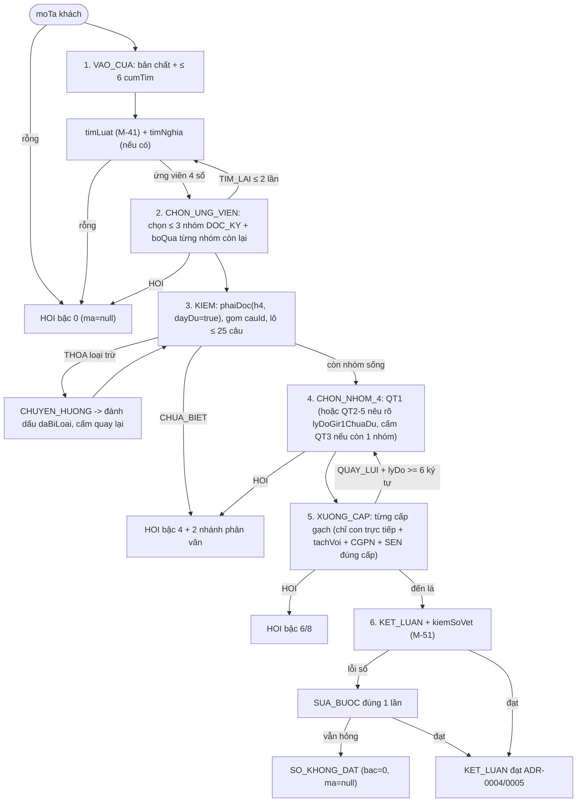

# M-52 (#1920) — Động cơ `phan_loai_hs` đọc luật trước, kết luận sau (`lib/engine-doc-luat.js`)

## 1. Mục tiêu và phạm vi thẻ
- Triển khai `chayDocLuat({ moTa, goiLLM, kho, gioiHan })` trong [`lib/engine-doc-luat.js`](../../../lib/engine-doc-luat.js) theo nguyên tắc **đọc luật gốc trước, kiểm sổ ghi vết xong mới kết luận** (ADR-0004, ADR-0005).
- Bộ kiểm thử ngoại tuyến 14 kịch bản Chương 76 tự soạn + `goiLLM` giả định đặt tại [`scripts/test-engine-doc-luat.mjs`](../../../scripts/test-engine-doc-luat.mjs) và đăng ký ngay sau `test-so-vet.mjs` trong [`scripts/danh-sach-test.txt`](../../../scripts/danh-sach-test.txt).
- **Chưa nối vào đường khách (`api/`, `lib/classify*.js`, `lib/engine-loop.js`)** và **không thêm bất kỳ biến môi trường `HS_*` nào**, chờ gộp các nhánh nền (M-34, M-41, M-51) và đánh giá chính thức của CEO + QT.

## 2. Luồng máy trạng thái 6 bước

## 3. Tương thích khi kho bổ trợ chưa gộp (`thieuKho`)
Động cơ trả danh sách `thieuKho` minh bạch khi các kho chưa có trên cây hiện tại:
- `M-33:nghia-canh` — khi chưa có `data/luat-goc/nghia-canh.jsonl`; `layCanhKiemBatBuoc` fallback sang cạnh `NHAC` dưới câu dẫn loại trừ.
- `M-36:tom-tat` — khi chưa có `data/luat-goc/tom-tat/*.jsonl` hoặc `kho.tomTat`; khi có, bước `CHON_UNG_VIEN` hiển thị tóm tắt `BO_TRO` (`gom`, `khongGom`) và bước `XUONG_CAP` hiển thị `tachVoi`.
- `M-37:tim-nghia` — khi chưa truyền `kho.timNghiaFn`; chỉ chạy tìm chữ qua `timLuat`.

Lưu ý phòng rò rỉ ngữ cảnh ở bước `XUONG_CAP`: `thuThapPhanPhaiDoc(..., { chiCapHienTai: true, daInMuc })` chỉ đưa `CHU_GIAI_PHAN_NHOM` (khử trùng lặp giữa các nút anh em) và `SEN` có độ dài mã không vượt quá bậc nút đang xét, tránh lặp lại toàn bộ Phần/Chương/Nhóm hoặc lộ mã `SEN` 8 số cấp cháu (ví dụ từ `bieu:7616` xuống `bieu:76169` giảm tổng độ dài prompt bước `XUONG_CAP` ở ca chuẩn từ `85.374` ký tự xuống `5.324` ký tự).

## 4. Kết quả đo 14 kịch bản Chương 76 (`node scripts/test-engine-doc-luat.mjs --do`)

| # | Kịch bản | Trạng thái | Bậc | Mã | Lượt LLM | Ký tự đã đọc | Phân bổ lượt / ký tự theo bước |
|---|---|---|---:|---|---:|---:|---|
| 1 | Đủ dữ kiện Chương 76 → `76161090` | `KET_LUAN` | 8 | `76161090` | 6 | 49.327 | `VAO_CUA`: 1/342, `CHON_UNG_VIEN`: 1/6.953, `KIEM`: 1/20.175, `CHON_NHOM_4`: 1/16.533, `XUONG_CAP`: 2/5.324 |
| 2 | Mô tả rỗng | `HOI` | 0 | `null` | 0 | 0 | — |
| 3 | Tìm rỗng từ `timLuat` | `HOI` | 0 | `null` | 1 | 299 | `VAO_CUA`: 1/299 |
| 4 | `TIM_LAI` tối đa 2 lần, lần 3 bị chặn | `KET_LUAN` | 8 | `76161090` | 9 | 66.660 | `VAO_CUA`: 1/288, `CHON_UNG_VIEN`: 4/24.556, `KIEM`: 1/20.121, `CHON_NHOM_4`: 1/16.479, `XUONG_CAP`: 2/5.216 |
| 5 | Thiếu `boQua` ở `CHON_UNG_VIEN` bị bắt bổ sung | `KET_LUAN` | 8 | `76161090` | 7 | 51.388 | `VAO_CUA`: 1/287, `CHON_UNG_VIEN`: 2/9.289, `KIEM`: 1/20.120, `CHON_NHOM_4`: 1/16.478, `XUONG_CAP`: 2/5.214 |
| 6 | Gộp `cauId` (`gopTheoCau=true`), lô `<= 10` | `KET_LUAN` | 8 | `76161090` | 7 | 63.024 | `VAO_CUA`: 1/273, `CHON_UNG_VIEN`: 1/4.567, `KIEM`: 2/36.534, `CHON_NHOM_4`: 1/16.464, `XUONG_CAP`: 2/5.186 |
| 7 | Không lộ cháu & chặn chọn nhảy cấp ở `XUONG_CAP` | `KET_LUAN` | 8 | `76161090` | 7 | 49.428 | `VAO_CUA`: 1/277, `CHON_UNG_VIEN`: 1/4.571, `KIEM`: 1/20.110, `CHON_NHOM_4`: 1/16.468, `XUONG_CAP`: 3/8.002 |
| 8 | Nạp `kho.tomTat` (M-36) & `timNghiaFn` (M-37) | `KET_LUAN` | 8 | `76161090` | 6 | 46.756 | `VAO_CUA`: 1/268, `CHON_UNG_VIEN`: 1/4.659, `KIEM`: 1/20.101, `CHON_NHOM_4`: 1/16.459, `XUONG_CAP`: 2/5.269 |
| 9 | `CHUYEN_HUONG` `7604` → `7610`, cấm chọn lại `7604` | `KET_LUAN` | 8 | `76101010` | 8 | 78.043 | `VAO_CUA`: 1/324, `CHON_UNG_VIEN`: 1/5.110, `KIEM`: 2/36.419, `CHON_NHOM_4`: 2/31.015, `XUONG_CAP`: 2/5.175 |
| 10 | `CHUA_BIET` ở `KIEM` → dừng `HOI` bậc 4 | `HOI` | 4 | `7604` | 3 | 23.121 | `VAO_CUA`: 1/279, `CHON_UNG_VIEN`: 1/5.065, `KIEM`: 1/17.777 |
| 11 | `HOI` ở `XUONG_CAP` (dừng tại `761610`) | `HOI` | 8 | `761610` | 6 | 49.177 | `VAO_CUA`: 1/317, `CHON_UNG_VIEN`: 1/6.928, `KIEM`: 1/20.150, `CHON_NHOM_4`: 1/16.508, `XUONG_CAP`: 2/5.274 |
| 12 | `QUAY_LUI` từ `76169` về `7616` đòi `lyDo` | `KET_LUAN` | 8 | `76161090` | 9 | 54.389 | `VAO_CUA`: 1/273, `CHON_UNG_VIEN`: 1/4.567, `KIEM`: 1/20.106, `CHON_NHOM_4`: 1/16.464, `XUONG_CAP`: 5/12.979 |
| 13 | Cấm `QT3` khi còn 1 nhóm sống | `KET_LUAN` | 8 | `76161090` | 7 | 63.185 | `VAO_CUA`: 1/280, `CHON_UNG_VIEN`: 1/4.574, `KIEM`: 1/20.113, `CHON_NHOM_4`: 2/33.018, `XUONG_CAP`: 2/5.200 |
| 14 | `SUA_BUOC` 1 lần được → `KET_LUAN`; hỏng → `SO_KHONG_DAT` | `KET_LUAN` | 8 | `76161090` | 7 | 46.713 | `VAO_CUA`: 1/263, `CHON_UNG_VIEN`: 1/4.557, `KIEM`: 1/20.096, `CHON_NHOM_4`: 1/16.454, `XUONG_CAP`: 2/5.166, `SUA_BUOC`: 1/177 |

## 5. Giới hạn tự kiểm chứng (ngoại tuyến)
- Toàn bộ kết quả trên chạy bằng mô tả Chương 76 tự soạn và `goiLLM` giả lập có kiểm soát (`nhietDo: 0`); **chưa đo bằng LLM thật** qua Gateway và **chưa nối vào luồng phục vụ khách hàng**.
