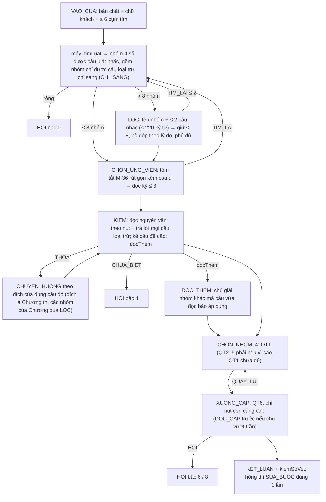

# M-52 (#1920) — Động cơ `phan_loai_hs` đọc luật trước, kết luận sau (`lib/engine-doc-luat.js`)

## 1. Phạm vi
- `chayDocLuat({ moTa, goiLLM, kho, gioiHan })`: máy chỉ đưa đúng thứ phải đọc ở từng bước, ghi sổ, kiểm sổ. Máy không xếp hạng, không đổi kết luận của LLM (ADR-0004, ADR-0005).
- **Chưa nối** vào `api/`, `lib/classify*.js`, `lib/engine-loop.js`. Không thêm biến môi trường.
- Nền: `origin/main` (có M-10, M-31, M-32) + M-34 #1939 (`71cffed6`) + M-41 #1944 (`ecff7e0e`) + M-51 #1945 (`ef60746e`).

## 2. Các bước

## 3. Năm yêu cầu QT (#1955, soát `16ec301d`) và chỗ làm

| # | Yêu cầu | Đã làm | Cổng giữ |
|---|---|---|---|
| 1 | Tách LOC / CHON | `LOC`: tên + ≤ 2 câu ≤ 220 ký tự (tên nhóm → chú giải nhóm → dòng sâu hơn → Phần/Chương/SEN; luôn chừa chỗ cho câu CHI_SANG), có `chieu`, xếp theo số nhóm; giữ ≤ 8; `boQua:[{lyDo, nhom:[…]}]` phủ đủ. `CHON_UNG_VIEN`: `khongGom` đủ, `tachVoi` chỉ với nhóm đang xét, `gom` bỏ ý chỉ dựa câu Phần/Chương, mọi ý kèm cauId | ca 16, 17 |
| 2 | Trần 60.000 ký tự | Chia lượt theo nhóm / nút, không cắt chữ; `thongKeBuoc` ghi `kyTuLonNhat`, `soLuotChia`; vượt trần thì `SO_KHONG_DAT`, không gọi | ca 17, 18, 22 |
| 3 | Phần/Chương một lần | Nút Phần/Chương đã đưa không đưa lại; câu chung đã trả KHONG được dùng lại (`dungLaiTu`), câu THOA hỏi lại cho nhóm mới | ca 19 |
| 4 | CHI_SANG | Câu `LOAI` có cạnh NHAC sang nhóm khác → nhóm đó vào LOC kèm đúng câu | ca 15 |
| 5 | Bài kiểm + sổ | 30 cụm tự nghĩ trên kho thật (tóm tắt giả 11.000 ký tự/nhóm): prompt lớn nhất **46.811**; sáu nhóm nặng nhất (39.01, 32.04, 29.37, 40.01, 61.09, 84.19) đều ≤ 60.000. `so-vet` thêm loại bước `LOC` | `LOC_KHONG_PHU_DU`, `KIEM_NGOAI_LOC` (test-so-vet 6 ca) |

## 4. Chạy thử thật một món tự nghĩ

> Khung cửa sổ bằng nhôm định hình (hợp kim nhôm), đã cắt, khoan và lắp góc sẵn, có sẵn rãnh lắp kính nhưng chưa lắp kính, dùng lắp vào tường nhà ở

Mô hình `gemini-4-hydrogen-high` qua `agy -p` (dòng lệnh này không đặt được nhiệt độ). Chạy 2 lần trọn; sổ lần 2 ở `/home/oz/demo52-so.json` (máy .131), `kiemSoVet` đạt, 8 bước, 0 lỗi. Trước khi sửa: dừng ở bước CHON vì prompt 113.225 ký tự.

| Lượt | Bước | Ký tự prompt | Nút / quyết định | Câu trích, cạnh |
|---:|---|---:|---|---|
| 1 | VAO_CUA | 711 | 4 ý bản chất, 6 cụm tìm → 32 nhóm | chữ khách kiểm nguyên văn |
| 2 | LOC | 12.567 | 32 nhóm → giữ 7604, 7610, 8302; bỏ 29 nhóm theo 4 lý do | `bieu:7610#1`, `nhom:7610:ct:2#1`, `nhom:8302:ct:1#3`… |
| 3 | CHON_UNG_VIEN | 8.975 | đọc kỹ 7610; bỏ 7604 (`nhom:7604:ct:2#1`, `ct:3#1`, `phan:XV:cg:9:b#2`), bỏ 8302 (`nhom:8302:ct:1#3`) | |
| 4 | KIEM `bieu:7610` | 20.537 | 18/18 câu loại trừ KHONG: `phan:XV:cg:1:a…n` (13), `phan:XV:cg:2:ket#1`, `phan:XV:kq:4#7`, `nhom:7610:ct:5…7`; xin `docThem` 73.08 | kê 8 câu đề cập |
| 5 | DOC_THEM 73.08 | 6.013 | do `nhom:7610:ct:1#1` "nội dung chú giải nhóm 73.08 được áp dụng" | kê `nhom:7308:ct:1#1`, `#2`, `#3`, `ct:4#1` |
| 6 | CHON_NHOM_4 | 6.301 | `bieu:7610`, QT1 (một nhóm) | `gir:1#2`, `phan:XV:cg:6#1`, `bieu:7610#1`, `nhom:7610:ct:3#1`, `nhom:7308:ct:1#1`, `#2` |
| 7 | XUONG_CAP 7610 | 6.394 | `bieu:761010`; không chọn 761090 | `gir:6#1`, `#2`, `bieu:761010#1`, `nhom:7308:ct:1#1` |
| 8 | XUONG_CAP 761010 | 5.188 | `bieu:76101090`; không chọn 76101010 (chỉ cửa ra vào) | `gir:6#1`, `bieu:761010#1`, `bieu:76101090#1` |

Kết thúc: `KET_LUAN` bậc 8 `76101090`, **8 lượt, 66.686 ký tự**, 0 lượt bị trả lại. Lần 1 (trước khi sửa các chỗ hở ở mục 5): 8 lượt, 98.073 ký tự, 69 nhóm vào LOC, 1 lượt KIEM bị trả lại.

## 5. Chỗ hở của QUY TRÌNH

### Đã sửa
1. **LLM bị trả cả bước KIEM vì chép sai một câu phụ** (`phan:XV:cg:9:b#2`), tốn thêm 26.000 ký tự, 68 giây. Nay `cauDeCap` chỉ kê cauId + ý, máy chép nguyên văn.
2. **Câu bảo áp dụng chú giải nhóm khác không ai đưa** (kho có khoảng 82 câu loại này). Nay LLM xin `docThem`, máy chỉ cho nhóm mà câu trong lượt thật sự dẫn tới; nhóm đó không thành ứng viên.
3. **Cụm có dấu khớp câu không dấu** ("nhôm" ~ "nhóm"): 69 → 32 nhóm vào LOC, prompt 26.990 → 12.567. Động cơ bỏ kết quả `*_KHONG_DAU` khi cụm có dấu.
4. **`daDoc` khai khống**: bản cũ ghi đã đọc cả câu chưa in vào prompt. Nay `daDoc` chỉ lấy từ câu thật sự đã đưa trọn; trích câu chưa đưa bị trả lại.
5. **`chuKhach` không kiểm**: nay phải có nguyên văn trong mô tả (hoặc `KHACH_KHONG_NEU` ở KIEM, trừ THOA).
6. **Chỉ trích lời Quy tắc cũng qua cổng**: nay phải có ít nhất một câu tên nhóm / phân nhóm / chú giải; `daSoKhongChon` phải đủ mọi nút cùng cấp.
7. **Nút con không in cauId** (LLM phải đoán id để trích) và **SUA_BUOC không cho LLM thấy bước hỏng**: đã in; SUA_BUOC chỉ nhận phần LLM viết, máy giữ `daDoc`, nút, quyết định.
8. **Chuyển hướng sang cả Chương thì mất nhóm**; đích chuyển hướng không buộc là đích của câu THOA: đã sửa.
9. **`so-vet`: chọn cấp 7 số xoá luôn căn cứ tầng 6**, nên mọi dòng 8 số nằm dưới gạch 7 số (vd 40011011) không thể đạt. Đã sửa trong `lib/so-vet/kiem.js` (thuộc M-51).
10. Câu nhắc ở LOC lộ dòng 8 số và lặp tên nhóm: xếp tên nhóm → chú giải nhóm trước, tên nhóm không in lại.

### Còn lại (không sửa trong thẻ này)
- **M-33 chưa có**: cạnh loại trừ lấy từ NHAC nên sót câu như `phan:XV:cg:2:ket#2` (Chương 82, 83 loại khỏi 72–76); chiều tìm của M-41 ghi `nhom:8302:ct:1#3` ("không mở rộng cho… khung cửa sổ") là NHAC.
- **M-31**: ba nút (`phan:XI:kq:2`, `phan:XV:kq:4`, `phan:XVI:kq:1`) có danh sách loại trừ (a)…(l) trong cùng nút nhưng các câu sau câu đầu không có `dan`, nên không thành câu phải kiểm.
- **Nhóm bỏ ở CHON_UNG_VIEN dựa trên tóm tắt M-36** (có cauId), chưa đọc nguyên văn chú giải nhóm đó; bước CHON tầng 4 chỉ còn một nhóm nên không có nhóm để so ngoài sổ LOC.
- **SEN của dòng 8 số được đưa ngay ở KIEM 4 số** vì `kiemSoVet` (M-51) buộc đọc hết SEN của nhóm; trái tinh thần "không thấy cấp dưới". Cần M-51 đổi phạm vi SEN theo cấp.
- **36 tên dòng biểu ngắn hơn 6 ký tự** ("- Khô", "- Bơ") không trích được vì `TRICH_TOI_THIEU = 6` ở `lib/cong-adr-0004.js`; tạm trích tên nút cha.
- **CHUA_BIET ở nhóm đầu thì hỏi ngay**, chưa đọc các nhóm còn lại.
- **Máy chủ trước (B0)**: chưa có bước riêng cho hàng là bộ phận; sổ chưa đặt `laBoPhan` / `mayChu`.
- Món thử đi thẳng: nhánh THOA, CHUA_BIET, HOI, QUAY_LUI mới kiểm bằng LLM giả.
- M-36 mới có 578/1.269 nhóm; nhóm thiếu thì ghi `M-36:tom-tat:<nhóm>` vào `thieuKho` và đưa tới 4 câu nhắc. M-37 chưa cắm.

## 6. Kiểm ngoại tuyến (`node scripts/test-engine-doc-luat.mjs --do`, LLM giả)

24 ca đạt (14 ca cũ + 10 ca mới). Số đo các ca cũ:

| # | Kịch bản | Trạng thái | Bậc | Mã | Lượt | Ký tự |
|---|---|---|---:|---|---:|---:|
| 1 | Đủ dữ kiện Chương 76 | KET_LUAN | 8 | 76161090 | 7 | 37.297 |
| 2 | Mô tả rỗng | HOI | 0 | | 0 | 0 |
| 3 | Tìm rỗng | HOI | 0 | | 1 | 615 |
| 4 | TIM_LAI tối đa 2 lần | KET_LUAN | 8 | 76161090 | 10 | 41.167 |
| 5 | CHON_UNG_VIEN sót lý do bỏ | KET_LUAN | 8 | 76161090 | 8 | 38.289 |
| 6 | KIEM lô ≤ 10 câu | KET_LUAN | 8 | 76161090 | 8 | 37.955 |
| 7 | Không lộ cháu, chặn nhảy cấp | KET_LUAN | 8 | 76161090 | 8 | 40.639 |
| 8 | Có M-36, M-37 | KET_LUAN | 8 | 76161090 | 7 | 36.911 |
| 9 | CHUYEN_HUONG 7604 → 7610 | KET_LUAN | 8 | 76101010 | 9 | 41.464 |
| 10 | CHUA_BIET → HOI | HOI | 4 | 7604 | 4 | 25.452 |
| 11 | HOI ở XUONG_CAP | HOI | 8 | 761610 | 7 | 37.104 |
| 12 | QUAY_LUI | KET_LUAN | 8 | 76161090 | 10 | 43.695 |
| 13 | Cấm QT3 khi còn 1 nhóm | KET_LUAN | 8 | 76161090 | 8 | 40.517 |
| 14 | SUA_BUOC | KET_LUAN | 8 | 76161090 | 8 | 37.035 |

Lần trước (`c311afe8`) ca 1 là 49.327 ký tự.
